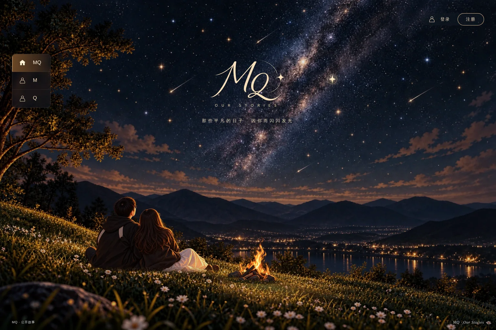

# MQ · Our Stories

**A small self-hosted blog, from database permissions to backup recovery.**

MQ Story is a working engineering reference built with Next.js and PostgreSQL. It connects story editing and publishing with separate database identities, protected Session storage, container deployment and encrypted backups. The starry sky and feather-letter reader are the product these decisions serve.

[](https://github.com/SynapseOperator/mq-story-blog/actions/workflows/ci.yml)

[Live site](https://mq-story.xyz) · [简体中文](README.md) · [Development guide (Chinese)](docs/DEVELOPMENT.md) · [Docs](docs/README.md)

If you are building a small self-hosted application, the useful parts here include authorization within a transaction, least-privilege database access, private image reads, and recovery of database records together with their files. You can build a different story blog on this code, but the original artwork has separate terms: replace it with resources you have permission to use. This is primarily an engineering reference, not an unrestricted visual theme package.



This is an actual production screenshot. The original and its provenance are preserved in [the screenshot notes](docs/showcase/README.md). Detailed documentation is currently in Chinese.

## What to read first

- [Database identities and authorization](docs/guides/DATABASE_IDENTITIES.md): what the application may do, and why maintenance uses different credentials.
- [Database and media backup recovery](docs/guides/BACKUP_AND_RESTORE.md): consistency, encrypted storage and a restore that can be checked.
- [Deployment lifecycle](docs/engineering/PRODUCTION_LAUNCH.md): separate initialization, upgrades, private previews and public activation.

Current contracts are in the [documentation index](docs/README.md). Dated experiments and course records live in [the archive](docs/archive/README.md).

## Try it locally

You need Node **24.22.2**, npm **11.21.2**, and a running Docker Engine/Desktop with Linux containers and Compose. Windows PowerShell users can use `npm.cmd`.

```sh
git clone https://github.com/SynapseOperator/mq-story-blog.git
cd mq-story-blog
npm ci
npm run demo
```

The demo creates its own database and volumes, applies migrations, generates local accounts, and adds synthetic stories and images through the application APIs. Open **http://127.0.0.1:3030** to read a story or try the administrator workspace. You do not need cloud credentials, live-site data or a private certificate.

The first run downloads and builds an image; timing depends on your connection and machine. Later starts reuse the image and your demo data. This is a local HTTP demonstration, not a production installation, and should not hold private content.

```sh
npm run demo:credentials  # View local accounts in your interactive terminal
npm run demo:status       # Show the local address and service status
npm run demo:stop         # Stop services, preserving data and accounts
npm run demo             # Resume without reseeding
```

For hot reload and separate development databases, use the [development guide](docs/DEVELOPMENT.md). `npm run dev` still works for scene development; without a database, it does not invent demo stories or hide an API failure.

## Application features

- Seven story stars and a campfire entry, with mouse, keyboard, touch and reduced-motion support.
- A letter reader with images, stable `/stories/:slug` links, browser history and unsent-comment prompts.
- Likes for signed-in readers; anonymous or signed-in comments that appear only after moderation.
- A single-administrator workspace for drafts, images, star-position previews, publishing, withdrawal and restoration. Editing a draft does not replace its published revision.
- Private content checks, independently encrypted Session storage and distinct database identities for application and maintenance work.

The M / Q pages are placeholders. There are no comment reply trees, attachments or rich-text editor. An openly licensed default theme, configurable star positions and documentation translations are directions in the [Roadmap](docs/ROADMAP.md), not implemented features.

## Stack and checks

Next.js 16 App Router, React 19, TypeScript, Node.js 24, Better Auth, PostgreSQL 18, Prisma 7, Sharp, Docker Compose, Caddy and Restic. Exact versions are in [package-lock.json](package-lock.json); the [Chinese README](README.md) includes the architecture diagram and directory guide.

```sh
npm run check
```

This runs lint, Prisma Schema validation, type checking, Node tests and a production build, without requiring a database connection.

| Entry point | Scope |
| --- | --- |
| `npm run test:unit` | Unit and configuration tests |
| `npm run test:integration` | Core PostgreSQL and authentication tests; needs the guarded test database and application build |
| `npm run test:e2e` | Synthetic HTTPS deployment and browser regression |
| `npm run test:ops` | Isolated backup, restore and operational failure tests |
| `npm run test:demo` | Local demo startup, persistence, permissions and reader experience |

Image, database and browser prerequisites are documented in the [development guide](docs/DEVELOPMENT.md). Fine-grained commands remain available for focused work. Never point tests at a production database.

The `quality`, `database` and `container` GitHub Actions checks are required on main, together with independent review and resolved review discussions. The badge links to actual run results.

## Deployment

The live site runs on a single Ubuntu VPS with Compose, PostgreSQL and Caddy. Restic encrypts the database and private-media backups before sending them to S3-compatible off-site storage. Real-server deployment and isolated recovery have been exercised; the website first launched on November 12, 2026.

To host your own instance, prepare your own domain, database identities, administrator and secret files. Start with the [production configuration guide](docs/engineering/PRODUCTION_FOUNDATION.md) and [release procedure](docs/engineering/PRODUCTION_LAUNCH.md). Build versioned images on a build machine or CI before transferring them to a small VPS. Backup and monitoring templates require configuration for your installation.

## License and contribution

Program code is [MIT licensed](LICENSE), with copyright held by SynapseOperator and SnorkelingBreather. The original artwork and screenshots containing it are **not covered by MIT**. They may be displayed, downloaded and forked as part of this repository; independent reuse needs permission from the relevant rights holders where those rights exist. Live-site stories, photos and comments are not licensed with the source. See [ASSETS_LICENSE.md](ASSETS_LICENSE.md).

Small, reproducible improvements are welcome; see [CONTRIBUTING.md](CONTRIBUTING.md), [Roadmap](docs/ROADMAP.md) and [CHANGELOG](CHANGELOG.md). Report vulnerabilities privately through [GitHub Security Advisories](https://github.com/SynapseOperator/mq-story-blog/security/advisories), following [SECURITY.md](SECURITY.md). Never include credentials or private content in public issues.
