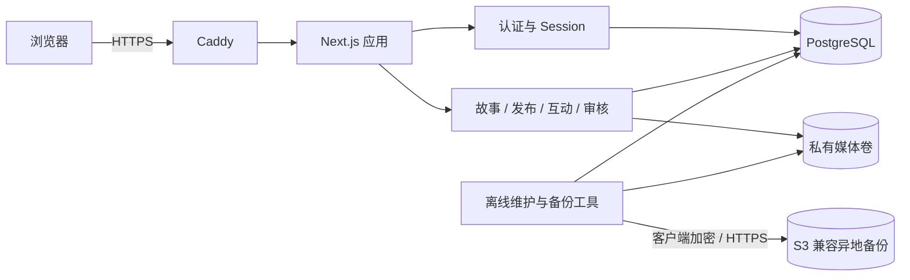

# MQ · Our Stories

**把故事放进星空，把回忆写成一封信。**

MQ Story 是一个围绕共同回忆搭建的个人博客。点开首页的星星或篝火，就能读到对应的故事。文字和照片放在一张羽毛信纸里，读完可以点个赞，也可以留下一句话。

这个项目也用于软件工程与 DevOps 课程实践。从后台编辑、留言审核，到数据库迁移、容器部署和备份恢复，仓库保留了实现过程与工程记录。网站于 **2026-11-12** 上线，代码于 **2026-11-16** 公开。

[在线体验](https://mq-story.xyz) · [本地开发](docs/DEVELOPMENT.md) · [文档索引](docs/README.md) · [参与贡献](CONTRIBUTING.md)


<p align="center">
  
  &nbsp;&nbsp;
  
</p>

上面的首页截图来自在线网站。阅读器截图取自本地生产构建，文章和图片均为测试内容，未使用私人故事。[查看截图来源与版本](docs/showcase/README.md)。

## 可以做什么

- **星空与篝火**：7 个预设故事星位，以及一个篝火故事入口。只有已发布的故事可以打开；支持鼠标、键盘和触屏，也遵循系统的减少动态效果偏好。
- **读信与分享**：正文、图片、点赞和留言都在信纸内滚动。每篇故事有自己的 `/stories/:slug` 链接，支持浏览器前进后退；关闭阅读层时会提醒尚未提交的留言。
- **点赞与留言**：登录后可以点赞、取消点赞。游客可以匿名留言，登录用户也可以选择匿名；留言通过审核后才会展示并计入公开数量。
- **作者后台**：管理员可以编辑草稿、上传图片、预览星位，并发布、更新、下架或恢复故事。已占用的星位不能重复绑定，保存草稿也不会改动正在展示的版本。
- **账号与内容权限**：PostgreSQL 保存故事、修订、账号和互动记录。草稿与私有图片按权限读取；Session 使用独立密钥加密存储，管理操作仅向唯一管理员开放。
- **自行部署**：提供 Docker Compose、Caddy HTTPS、私有媒体卷，以及 Restic 加密备份和隔离恢复工具。应用、迁移、维护与备份使用各自的数据库身份。

M / Q 页面目前保留为建设中入口；不包含回复树、附件或富文本编辑器。

## 技术栈

| 层次 | 当前实现 |
| --- | --- |
| 前端 | Next.js 16 App Router · React 19 · TypeScript · CSS / Tailwind CSS 4 |
| 服务端 | Node.js 24 · Route Handlers · Better Auth 1.7.12 |
| 数据 | PostgreSQL 18 · Prisma 7 · 显式 SQL 迁移与约束 |
| 图片 | Sharp 处理 · 私有文件目录 · 受控读取接口 |
| 部署 | Docker Compose · 非 root 应用容器 · Caddy |
| 验证与运维 | Node 原生测试 · Playwright · 真实 PostgreSQL / HTTP / HTTPS · Restic |

精确依赖以 [package-lock.json](package-lock.json) 为准；开发工具链固定 Node **24.22.2**（[.nvmrc](.nvmrc)）和 npm **11.21.2**。

## 系统架构

项目采用模块化单体：一个 Next.js 应用，按认证、故事、媒体、点赞、留言划分服务端模块。



公网请求由 Caddy 转发给应用，数据库和应用内部端口留在容器网络。数据结构和权限设计见 [数据库](docs/engineering/DATABASE.md)、[生产基础](docs/engineering/PRODUCTION_FOUNDATION.md)及[Session 存储](docs/engineering/SESSION_STORAGE.md)。

## 目录导航

| 目录 | 职责 |
| --- | --- |
| `src/app/` | 页面、分享路由和 HTTP API |
| `src/components/` | 星空、羽毛信、认证与管理员界面 |
| `src/server/` | 认证、权限和各业务模块的事务服务 |
| `src/lib/` | DTO、客户端请求、编辑器状态与共享规则 |
| `prisma/` | Schema 与只增不改的 SQL 迁移 |
| `scripts/` | 本地环境、集成验证、维护与发布工具 |
| `ops/`、`config/` | Caddy、运维模板和数据库配置 |
| `tests/` | 单元、配置与安全边界测试 |
| `public/`、`docs/` | 静态素材、开发说明与历史工程记录 |

## 本地快速开始

准备 Node/npm；完整数据库功能还需要 Docker Engine 与 Compose。下列命令均从仓库根目录运行；Windows PowerShell 可以使用 `npm.cmd`。

```sh
git clone https://github.com/SynapseOperator/mq-story-blog.git
cd mq-story-blog
npm ci
npm run dev -- --hostname 127.0.0.1
```

打开 <http://127.0.0.1:3000>，就可以查看和修改首页场景。这时还没有连接数据库，故事目录会显示读取失败／重试，登录也尚未启用。仓库已公开，可以直接克隆。

若要继续开发注册、登录和数据相关功能，可在全新的本地环境中执行：

```sh
npm run db:env
npm run db:up -- dev
npm run db:migrate
npm run auth:env
npm run dev:auth
```

先停止前一个开发服务，再打开 <http://127.0.0.1:3000>。两个 `*:env` 命令会分别生成本地配置，并由 Git 忽略。若提示文件已存在，复用原文件即可；已有数据库卷需要与原来的密码保持对应，请保留这些配置和卷。

完整后台还需要配置低权限数据库身份、管理员及签名密钥。上面的默认数据库身份用于开发初始化，不能直接用于后台；注册得到的也只是普通账号。[开发指南](docs/DEVELOPMENT.md)分别介绍了基础开发、完整容器演练和长期自托管的做法。仓库没有默认管理员密码，也不会导入在线网站的数据。

## 验证与工程实践

```sh
npm run check
```

依次执行 lint、Prisma Schema 校验、类型检查、Node 测试和生产构建；不要求连接数据库。数据库和浏览器集成按实际改动另外运行：

| 范围 | 入口示例 |
| --- | --- |
| 数据与公开读取 | `npm run test:db` · `npm run test:public` |
| 认证与受保护 Session | `npm run test:auth` · `npm run test:auth:session-storage` |
| 后台与发布 | `npm run test:admin-editor` · `npm run test:publishing` |
| 点赞与留言 | `npm run test:likes` · `npm run test:comments` |
| 容器与备份恢复 | `npm run test:production:container` · `npm run test:production:operations` |

先阅读[测试前置条件与隔离规则](docs/DEVELOPMENT.md)，不要将测试指向真实生产数据库。迁移只增量添加；已有 001–010 不重写。源码通过 Issue → 分支 → PR → 独立 Review 交付。

[GitHub Actions](https://github.com/SynapseOperator/mq-story-blog/actions) 配置了 quality、database、container 三项检查，结果以对应提交的运行记录为准。此前因额度限制而采用的 CI 豁免及本地验证记录保留在相关 PR 和[工作流说明](docs/engineering/WORKFLOW.md)中；豁免不表示远端检查通过，也不自动适用于后续贡献。

## 部署

在线网站运行在香港的一台 Ubuntu VPS 上，使用 Compose、PostgreSQL 18 和 Caddy。数据库与私有图片由 Restic 加密后备份到阿里云 OSS 香港私有存储，已完成隔离恢复验证。

如果想部署自己的实例，需要准备自己的域名、数据库身份、管理员和秘密文件。建议先在构建机或 CI 生成带版本与摘要的镜像，再交付服务器，避免在小型 VPS 上反复构建源码。首次初始化、日常升级、私有预览和公网开放都有对应的工具与说明：

- [生产基础与配置合同](docs/engineering/PRODUCTION_FOUNDATION.md)
- [初始化、升级与开放流程](docs/engineering/PRODUCTION_LAUNCH.md)
- [备份与恢复](docs/engineering/PRODUCTION_BACKUP.md) · [运维手册](docs/engineering/OPERATIONS_RUNBOOK.md)

备份和监控模板需要按自己的环境配置、启用；部署完成后，也请实际检查 HTTPS、资源余量和恢复流程。原站的验证记录可供参考。

## 许可与素材

程序代码采用 [MIT License](LICENSE)，由 SynapseOperator 和 SnorkelingBreather 共同署名。代码可以按许可条款使用、修改和分发；开源前的检查及授权记录见[公开准备记录](docs/engineering/OPEN_SOURCE_READINESS.md)。

情侣角色、星空场景、羽毛信、MQ 标识和相关截图是这个项目的美术部分，**不纳入 MIT**。它们可以随本仓库展示、下载及 Fork；如果希望单独用于其他项目，请先取得相应权利人的许可。第三方依赖沿用各自许可证，网站上的故事、照片和留言也不随代码授权。具体范围见 [素材说明](ASSETS_LICENSE.md)。

## 参与贡献

如果你遇到了问题，或有想改善的地方，欢迎按 [贡献指南](CONTRIBUTING.md) 提交 Issue 或小 PR。说明复现步骤、预期效果和改动范围，会更方便讨论；涉及整体视觉或数据权限的改动，请先沟通。示例和截图请使用合成内容，不要附带密码、Token、私人故事或用户照片。

安全问题请通过 [GitHub 私密漏洞报告入口](https://github.com/SynapseOperator/mq-story-blog/security/advisories)联系维护者，提交前可阅读 [SECURITY.md](SECURITY.md)。更多技术说明、需求与工程记录都在[文档索引](docs/README.md)中。
