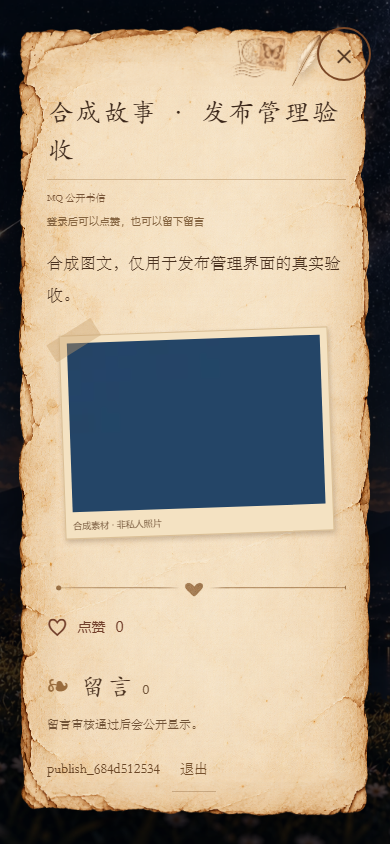
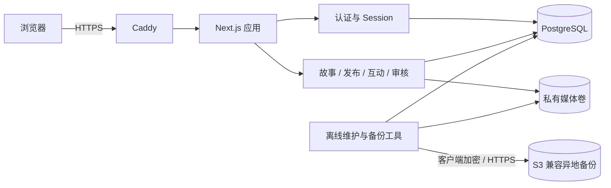

# MQ · Our Stories

**把故事放进星空，把回忆写成一封信。**

MQ Story 是一个以共同回忆为主题的个人博客，也是软件工程与 DevOps 课程项目。读者从星星或篝火进入故事，在同一张羽毛信纸中阅读、点赞和留言；作者在后台编辑草稿、管理图片、发布故事和审核留言。

[在线体验](https://mq-story.xyz) · [本地开发](docs/DEVELOPMENT.md) · [文档索引](docs/README.md) · [参与贡献](CONTRIBUTING.md)


<p align="center">
  
  &nbsp;&nbsp;
  
</p>

首页截图来自实际公网网站；阅读器截图来自隔离环境的真实生产构建，使用合成故事和非私人图片。[截图来源与版本](docs/showcase/README.md)。

## 可以做什么

- **星空阅读**：7 个固定故事星位和独立的篝火入口；桌面悬停、键盘和触屏交互，支持 reduced-motion。首页只显示已发布故事的入口。
- **羽毛信与分享**：段落、图片、点赞和留言在同一内部滚动区域；独立 `/stories/:slug` 链接、前进后退、焦点恢复及未提交留言保护。
- **真实互动**：登录点赞／取消点赞；游客匿名留言，登录用户可选账号或匿名身份。留言一律先审核，公开列表与计数只包含通过审核的内容。
- **作者工作区**：唯一管理员、草稿编辑、图片上传、星位预览与占用校验、发布／更新／下架／恢复。保存草稿不会改变已公开版本。
- **权限与持久化**：PostgreSQL 保存故事、修订、星位、账号、点赞及留言；公开接口不返回私有草稿。Session 使用独立密钥保护存储，保留框架的会话撤销语义。
- **自托管运维**：Docker Compose、Caddy HTTPS、数据库最小权限身份、私有媒体卷、Restic 加密备份及隔离恢复工具。

M / Q 页面目前保留为建设中入口；不包含回复树、附件或富文本编辑器。

## 技术栈

| 层次 | 当前实现 |
| --- | --- |
| 前端 | Next.js 16 App Router · React 19 · TypeScript · CSS / Tailwind CSS 4 |
| 服务端 | Node.js 24 · Route Handlers · Better Auth 1.7.12 |
| 数据 | PostgreSQL 18 · Prisma 7 · 显式 SQL 迁移与约束 |
| 图片 | Sharp 处理 · 私有文件目录 · 受控读取接口 |
| 部署 | Docker Compose · 非 root 应用容器 · Caddy |
| 验证与运维 | Node 原生测试 · Playwright · 真实 PostgreSQL / HTTP / HTTPS · Restic |

精确依赖以 [package-lock.json](package-lock.json) 为准；开发工具链固定 Node **24.22.2**（[.nvmrc](.nvmrc)）和 npm **11.21.2**。

## 系统架构

项目采用模块化单体：一个 Next.js 应用，按认证、故事、媒体、点赞、留言划分服务端模块。



只有反向代理提供公网入口。数据库和应用内部端口留在容器网络；迁移、维护、备份与应用运行身份分离。数据合同和限制见 [数据库](docs/engineering/DATABASE.md)、[生产基础](docs/engineering/PRODUCTION_FOUNDATION.md)及[Session 存储](docs/engineering/SESSION_STORAGE.md)。

## 目录导航

| 目录 | 职责 |
| --- | --- |
| `src/app/` | 页面、分享路由和 HTTP API |
| `src/components/` | 星空、羽毛信、认证与管理员界面 |
| `src/server/` | 认证、权限和各业务模块的事务服务 |
| `src/lib/` | DTO、客户端请求、编辑器状态与共享规则 |
| `prisma/` | Schema 与只增不改的 SQL 迁移 |
| `scripts/` | 本地环境、集成验证、维护与发布工具 |
| `ops/`、`config/` | Caddy、运维模板和数据库配置 |
| `tests/` | 单元、配置与安全边界测试 |
| `public/`、`docs/` | 静态素材、开发说明与历史工程记录 |

## 本地快速开始

准备 Node/npm；完整数据库功能还需要 Docker Engine 与 Compose。下列命令均从仓库根目录运行；Windows PowerShell 可以使用 `npm.cmd`。

```sh
git clone https://github.com/SynapseOperator/mq-story-blog.git
cd mq-story-blog
npm ci
npm run dev -- --hostname 127.0.0.1
```

打开 <http://127.0.0.1:3000>。这是**场景开发入口**：未连接数据库时不会自动填入故事，目录会显示读取失败／重试状态，也不会启用登录。当前仓库仍在开源准备阶段，克隆需要已有访问权限。

在全新开发环境中启用本地数据库和普通账号登录：

```sh
npm run db:env
npm run db:up -- dev
npm run db:migrate
npm run auth:env
npm run dev:auth
```

先停止前一个开发服务，仍使用 <http://127.0.0.1:3000>。两个 `*:env` 命令只创建被 Git 忽略的随机本地配置；发现已有文件时会保留并退出，不能为了重试随意删除已有配置或卷。

**后台、媒体和发布需要额外的低权限身份与签名配置。** 上面的本地数据库默认身份用于开发初始化，不是完整后台的运行身份；普通注册也不会授予管理员权限。按[开发指南](docs/DEVELOPMENT.md)选择基础开发、完整隔离演练或持久自托管路径，仓库不提供默认管理员密码或生产数据 seed。

## 验证与工程实践

```sh
npm run check
```

依次执行 lint、Prisma Schema 校验、类型检查、Node 测试和生产构建；不要求连接数据库。数据库和浏览器集成按实际改动另外运行：

| 范围 | 入口示例 |
| --- | --- |
| 数据与公开读取 | `npm run test:db` · `npm run test:public` |
| 认证与受保护 Session | `npm run test:auth` · `npm run test:auth:session-storage` |
| 后台与发布 | `npm run test:admin-editor` · `npm run test:publishing` |
| 点赞与留言 | `npm run test:likes` · `npm run test:comments` |
| 容器与备份恢复 | `npm run test:production:container` · `npm run test:production:operations` |

先阅读[测试前置条件与隔离规则](docs/DEVELOPMENT.md)，不要将测试指向真实生产数据库。迁移只增量添加；已有 001–010 不重写。源码通过 Issue → 分支 → PR → 独立 Review 交付。

[GitHub Actions](https://github.com/SynapseOperator/mq-story-blog/actions) 配置 quality、database、container 三项检查。近期远端运行受账户额度限制，相关交付使用负责人明确批准的 CI 豁免并保留本地证据；这不等同于远端 CI 成功，也不代表未来贡献自动豁免。

## 部署

实际网站于 **2026-11-12** 在香港 Ubuntu VPS 上线，使用单机 Compose + PostgreSQL 18 + Caddy；七星位已在后续增量升级中投入运行。生产备份使用 Restic 客户端加密及阿里云 OSS 香港私有存储，并已完成隔离恢复验收。

自托管应创建自己的域名、数据库身份、管理员和秘密文件，不复制原站配置或数据。优先在构建机／CI 生成固定源码与摘要绑定的候选，再交付服务器；首次初始化、升级、私有预览和公网开放分别使用已有工具。

- [生产基础与配置合同](docs/engineering/PRODUCTION_FOUNDATION.md)
- [初始化、升级与开放流程](docs/engineering/PRODUCTION_LAUNCH.md)
- [备份与恢复](docs/engineering/PRODUCTION_BACKUP.md) · [运维手册](docs/engineering/OPERATIONS_RUNBOOK.md)

工具和模板存在不代表所有运维任务已经自动启用。原站的部署证据不替代你自己的主机、HTTPS、资源和恢复验证。

## 许可与素材

**当前为开源准备版本，许可候选尚未生效。** 拟采用 MIT 授权程序代码；最终版权署名、共同作者授权及素材分发范围仍需权利人确认，见 [LICENSE](LICENSE) 与[公开前核验](docs/engineering/OPEN_SOURCE_READINESS.md)。

情侣角色、星空场景、羽毛信、MQ 标识及包含这些素材的截图**不自动纳入代码 MIT 许可**。第三方依赖保留各自许可证；故事正文、用户照片和留言也不属于代码授权。具体范围与待确认来源见 [ASSETS_LICENSE.md](ASSETS_LICENSE.md)。

## 参与贡献

先阅读 [CONTRIBUTING.md](CONTRIBUTING.md)。欢迎可复现的问题报告、文档改进和范围明确的小 PR；产品视觉与数据权限的改变请先讨论。不要在 Issue、PR、截图或日志中提交密码、Token、私人故事或用户照片。

安全问题请遵循 [SECURITY.md](SECURITY.md)，不要直接公开敏感细节。完整技术说明、需求与历史工程记录见[文档索引](docs/README.md)。
