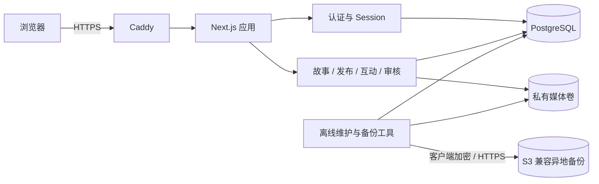

# MQ · Our Stories

**恋爱日常的寄存器，或属于编码人的浪漫，如果你在寻找一份浪漫的礼物，这就是你要的**

MQ Story 是一份可运行的自托管工程参考：用 Next.js 和 PostgreSQL 做故事编辑、发布与互动，再把数据库身份分离、受保护的 Session、容器部署和加密备份串成实际可验证的流程。星空和羽毛信是它的产品界面，也是这些工程能力服务的真实场景。

[](https://github.com/SynapseOperator/mq-story-blog/actions/workflows/ci.yml)

如果你正在做一个小型自托管应用，可以从这里借鉴事务内鉴权、最小权限数据库账号、私有图片读取，以及数据库和文件的一致性恢复。想做自己的故事博客，也可以在这些基础上替换主题；原站美术不随代码 MIT 授权独立复用，见[素材说明](ASSETS_LICENSE.md)。

[在线体验](https://mq-story.xyz) · [English](README.en.md) · [本地开发](docs/DEVELOPMENT.md) · [文档索引](docs/README.md) · [参与贡献](CONTRIBUTING.md)


<p align="center">
  
  &nbsp;&nbsp;
  
</p>

上面的首页截图来自在线网站。阅读器截图取自本地生产构建，文章和图片均为测试内容，未使用私人故事。[查看截图来源与版本](docs/showcase/README.md)。

[本地演示](#本地快速开始) · [功能](#可以做什么) · [工程导读](#从哪里读代码) · [测试](#验证与工程实践) · [部署](#部署) · [许可](#许可与素材)

## 从哪里读代码

| 想解决的问题 | 阅读入口 |
| --- | --- |
| 应用出错时，怎样限制数据库误操作的范围？ | [五类数据库身份与事务内授权](docs/guides/DATABASE_IDENTITIES.md) |
| 数据库和私有图片怎样一起备份、恢复后怎样验收？ | [小型自托管服务的备份与恢复](docs/guides/BACKUP_AND_RESTORE.md) |
| 怎样把构建产物交付到服务器，区分首次安装、升级和开放入口？ | [生产部署流程](docs/engineering/PRODUCTION_LAUNCH.md) |

不必先读完所有文档。现行说明集中在[文档索引](docs/README.md)，课程过程和失败实验保留在[工程档案](docs/archive/README.md)。

## 可以做什么

- **星空与篝火**：7 个预设故事星位，以及一个篝火故事入口。只有已发布的故事可以打开；支持鼠标、键盘和触屏，也遵循系统的减少动态效果偏好。
- **读信与分享**：正文、图片、点赞和留言都在信纸内滚动。每篇故事有自己的 `/stories/:slug` 链接，支持浏览器前进后退；关闭阅读层时会提醒尚未提交的留言。
- **点赞与留言**：登录后可以点赞、取消点赞。游客可以匿名留言，登录用户也可以选择匿名；留言通过审核后才会展示并计入公开数量。
- **作者后台**：管理员可以编辑草稿、上传图片、预览星位，并发布、更新、下架或恢复故事。已占用的星位不能重复绑定，保存草稿也不会改动正在展示的版本。
- **账号与内容权限**：PostgreSQL 保存故事、修订、账号和互动记录。草稿与私有图片按权限读取；Session 使用独立密钥加密存储，管理操作仅向唯一管理员开放。
- **自行部署**：提供 Docker Compose、Caddy HTTPS、私有媒体卷，以及 Restic 加密备份和隔离恢复工具。应用、迁移、维护与备份使用各自的数据库身份。

M / Q 页面目前保留为建设中入口；不包含回复树、附件或富文本编辑器。默认开放主题、星位配置化和文档翻译等后续方向见 [Roadmap](docs/ROADMAP.md)。

## 技术栈

| 层次 | 当前实现 |
| --- | --- |
| 前端 | Next.js 16 App Router · React 19 · TypeScript · CSS / Tailwind CSS 4 |
| 服务端 | Node.js 24 · Route Handlers · Better Auth 1.7.12 |
| 数据 | PostgreSQL 18 · Prisma 7 · 显式 SQL 迁移与约束 |
| 图片 | Sharp 处理 · 私有文件目录 · 受控读取接口 |
| 部署 | Docker Compose · 非 root 应用容器 · Caddy |
| 验证与运维 | Node 原生测试 · Playwright · 真实 PostgreSQL / HTTP / HTTPS · Restic |

精确依赖以 [package-lock.json](package-lock.json) 为准；开发工具链固定 Node **24.22.2**（[.nvmrc](.nvmrc)）和 npm **11.21.2**。

## 系统架构

项目采用模块化单体：一个 Next.js 应用，按认证、故事、媒体、点赞、留言划分服务端模块。



公网请求由 Caddy 转发给应用，数据库和应用内部端口留在容器网络。数据结构和权限设计见 [数据库](docs/engineering/DATABASE.md)、[生产基础](docs/engineering/PRODUCTION_FOUNDATION.md)及[Session 存储](docs/engineering/SESSION_STORAGE.md)。

## 目录导航

| 目录 | 职责 |
| --- | --- |
| `src/app/` | 页面、分享路由和 HTTP API |
| `src/components/` | 星空、羽毛信、认证与管理员界面 |
| `src/server/` | 认证、权限和各业务模块的事务服务 |
| `src/lib/` | DTO、客户端请求、编辑器状态与共享规则 |
| `prisma/` | Schema 与只增不改的 SQL 迁移 |
| `scripts/` | 本地环境、集成验证、维护与发布工具 |
| `ops/`、`config/` | Caddy、运维模板和数据库配置 |
| `tests/` | 单元、配置与安全边界测试 |
| `public/`、`docs/` | 静态素材、开发说明与历史工程记录 |

## 本地快速开始

准备上面列出的 Node/npm，以及运行中的 Docker Engine/Desktop（Linux 容器）和 Compose。Windows PowerShell 可以使用 `npm.cmd`。

```sh
git clone https://github.com/SynapseOperator/mq-story-blog.git
cd mq-story-blog
npm ci
npm run demo
```

演示会创建独立的本地数据库和卷，执行迁移，生成随机管理员与普通账号，并通过实际业务接口放入几篇合成故事和图片。打开终端给出的 **`http://127.0.0.1:3030`**，就能点星星、读信、登录和进入后台；不需要云账号、线上数据或私有证书。

第一次运行需要下载并构建镜像，耗时取决于网络和机器；后续启动复用镜像和自己的演示数据。不要把本地 HTTP 演示当作生产部署，也不要用它保存私人内容。

```sh
npm run demo:credentials  # 在自己的交互终端查看本地演示账号
npm run demo:status       # 查看地址和服务状态
npm run demo:stop         # 停止演示，保留数据库、图片和账号
npm run demo             # 恢复原演示，不重新灌入数据
```

只修改页面时仍可使用 `npm run dev`；不连数据库的开发模式不会自动填入演示文章。热更新、独立开发数据库、演示前提与故障处理见[开发指南](docs/DEVELOPMENT.md)。

## 验证与工程实践

```sh
npm run check
```

依次执行 lint、Prisma Schema 校验、类型检查、Node 测试和生产构建；不要求连接数据库。常用测试入口只有几组，原来的细分命令仍保留，方便定点排查：

| 入口 | 范围 |
| --- | --- |
| `npm run test:unit` | Node 单元与配置测试 |
| `npm run test:integration` | 核心数据库与认证集成；需要专用测试库与应用构建 |
| `npm run test:e2e` | 合成 HTTPS 环境中的完整业务和浏览器回归 |
| `npm run test:ops` | 隔离备份、恢复及运维故障验证 |
| `npm run test:demo` | 本地演示首启、停止恢复、权限与读信体验 |

先阅读[测试前置条件与隔离规则](docs/DEVELOPMENT.md)，不要将测试指向真实生产数据库。迁移只增量添加；已有 001–010 不重写。源码通过 Issue → 分支 → PR → 独立 Review 交付。

[GitHub Actions](https://github.com/SynapseOperator/mq-story-blog/actions) 的 **quality、database、container** 是 main 的必需检查，合并还需要独立审批并解决评审讨论。CI 使用标准 Linux Runner；结果以对应提交的真实运行记录为准。

## 部署

部署结构是一台 Ubuntu VPS、Compose、PostgreSQL 18 和 Caddy；Restic 把数据库与私有图片加密备份到 S3 兼容异地存储。项目已在实际服务器完成部署和隔离恢复验证，首次上线于 **2026-11-12**。

如果想部署自己的实例，需要准备自己的域名、数据库身份、管理员和秘密文件。建议先在构建机或 CI 生成带版本与摘要的镜像，再交付服务器，避免在小型 VPS 上反复构建源码。首次初始化、日常升级、私有预览和公网开放都有对应的工具与说明：

- [生产基础与配置合同](docs/engineering/PRODUCTION_FOUNDATION.md)
- [初始化、升级与开放流程](docs/engineering/PRODUCTION_LAUNCH.md)
- [备份与恢复](docs/engineering/PRODUCTION_BACKUP.md) · [运维手册](docs/engineering/OPERATIONS_RUNBOOK.md)

备份和监控模板需要按自己的环境配置、启用；部署完成后，也请实际检查 HTTPS、资源余量和恢复流程。原站的验证记录可供参考。

## 许可与素材

程序代码采用 [MIT License](LICENSE)，由 SynapseOperator 和 SnorkelingBreather 共同署名。代码可以按许可条款使用、修改和分发；开源前的检查及授权记录见[公开准备记录](docs/engineering/OPEN_SOURCE_READINESS.md)。

情侣角色、星空场景、羽毛信、MQ 标识和相关截图是这个项目的美术部分，**不纳入 MIT**。它们可以随本仓库展示、下载及 Fork；如果希望单独用于其他项目，请先取得相应权利人的许可。第三方依赖沿用各自许可证，网站上的故事、照片和留言也不随代码授权。具体范围见 [素材说明](ASSETS_LICENSE.md)。

## 参与贡献

如果你遇到了问题，或有想改善的地方，欢迎按 [贡献指南](CONTRIBUTING.md) 提交 Issue 或小 PR。说明复现步骤、预期效果和改动范围，会更方便讨论；涉及整体视觉或数据权限的改动，请先沟通。示例和截图请使用合成内容，不要附带密码、Token、私人故事或用户照片。

安全问题请通过 [GitHub 私密漏洞报告入口](https://github.com/SynapseOperator/mq-story-blog/security/advisories)联系维护者，提交前可阅读 [SECURITY.md](SECURITY.md)。更多技术说明、需求与工程记录都在[文档索引](docs/README.md)中。

版本进展见 [CHANGELOG](CHANGELOG.md)，适合参与的方向见 [Roadmap](docs/ROADMAP.md)。
