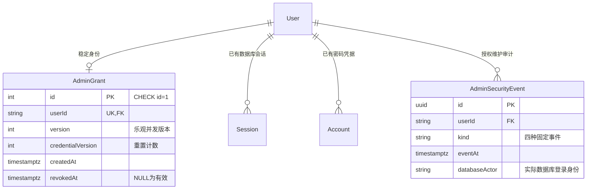

# P2-05：唯一管理员授权与权限边界

> 本文保留 P2-05 的实施范围与验证记录。当前后台编辑、发布、媒体、点赞和留言审核均已实现，网站已于 2026-11-12 上线；下文“本轮”“未来”指当时阶段。现行本地入口见[开发指南](../DEVELOPMENT.md)，生产管理员工具见 [PRODUCTION_ADMIN.md](PRODUCTION_ADMIN.md)，Session 存储以 [SESSION_STORAGE.md](SESSION_STORAGE.md) 为准。

对应 [Issue #17](https://github.com/SynapseOperator/mq-story-blog/issues/17)，承接 PRD v1.1 §02、§8.1、§10、访问权限要求与 FN-01/02/17。依赖已合并的 P2-03/#13 和 P2-04/#16，基础 main 为 `30ccf87cd59f23a1f749b7843badca9ae80e829a`。本轮只有授权基础、离线维护和最小权限检查页；没有文章编辑、发布 API、上传、点赞或审核。

## 数据关系与约束



新增 `202610250004_admin_authorization/migration.sql`；001、002、003 不变。迁移只建表/函数/触发器，不创建用户、授权或数据库角色。

| 数据库保证 | 机制 |
|---|---|
| 至多一个授权身份 | `AdminGrant.id` PK + CHECK=1；并发竞争由数据库裁决 |
| 撤销不释放给第二个账号 | 保留单例行；身份、创建时间不可变，DELETE/TRUNCATE 拒绝；User FK RESTRICT |
| 只有有效的生命周期变化 | 初始 active/version0；撤销与恢复恰好 version+1；重复操作、改绑及跳版本拒绝 |
| 密码重置与版本关联 | Account 密码触发器锁授权，再递增 version/credentialVersion；普通 UPDATE 不能伪造同状态版本变化 |
| 旧会话失效 | 授权、撤销、恢复、密码重置的触发器均删除该用户所有 Session；同一事务失败全部回滚 |
| 安全操作审计 | 同事务自动追加 GRANTED/REVOKED/RESTORED/CREDENTIAL_RESET；审计 UPDATE/DELETE/TRUNCATE 拒绝 |
| 授权与操作的并发次序 | `mq_lock_admin_access(sessionId,userId)` 持有 Grant→User→Session SHARE 锁直到调用事务结束；撤销/重置等待先开始的受保护操作完成 |
| 登录与重置的并发次序 | 专用账号登录在独立连接事务中使用 `mq_lock_admin_credentials(userId)` 持有 Grant SHARE 锁，完整认证响应和锁事务提交后才发送 Cookie；重置先取得同一 Grant UPDATE 锁 |

授权依据仅为稳定 User ID、有效数据库会话和未撤销授权。用户名、内部邮箱、Cookie 中额外 role 字段、请求头和前端状态均不参与授予权限。没有 User.role 唯一约束，也没有 Better Auth admin 插件。

选用保留单例而非删除旧授权后任意新建，是为了防止误初始化成第二个管理员并保留身份历史。当前可恢复同一账号；账号转移、删除或重新绑定**未实现**，需要后续单独审查的维护流程。

## 服务端边界与最小入口

`src/server/admin/access.ts` 导出 `withAdmin(request, operation)`：

1. 认证仍必须明确启用，配置/数据库不可用即拒绝；同源与可信代理契约沿用 P2-04，未来不安全方法必须有准确 Origin。
2. 对管理访问使用现有 PostgreSQL 原子共享限流（独立路径桶，客户端 240/分钟、全站 3000/分钟），不信任裸 XFF。
3. Better Auth 官方 `getSession` 验证签名 Cookie、数据库 Session；内部 `readVerifiedSession` 只向服务端返回用户 ID、用户名、Session ID、到期时间，既有公开 DTO 不变，没有 Token/email。
4. 在短 Prisma 事务内拒绝超级用户、迁移/维护权限、授权/密码/审计写权限、DDL 或角色成员资格漂移；调用数据库锁函数再次检查真实 User、会话归属/到期和有效授权。
5. 只在持有锁的事务回调中执行操作，返回最小数据。任何连接、SQL、配置错误拒绝为固定 `ADMIN_UNAVAILABLE`，原始异常不进入日志/响应。

所有未来管理 Route Handler 和管理服务必须复用此边界，回调仅使用传入 `tx`；不能拿一次鉴权结果去另起事务、缓存角色或在锁内等待外部服务。P2-03 故事服务尚未对外开放，未来接入需改为可接受同一事务的内部操作，不能跳过此边界。

数据库锁函数是固定 `search_path=pg_catalog`、显式 `public` 表名的窄 `SECURITY DEFINER` 函数，PUBLIC EXECUTE 已撤销。使用它的原因是 PostgreSQL `SELECT FOR SHARE` 自身需要 UPDATE 权限，不能给运行时授权表写权限来换取锁。函数只核验/加锁、不授予权限；签名 Cookie 验证仍必须由 Better Auth 完成。已开始的短事务可先完成，撤销提交之后旧会话不能开始新的管理操作；不声称能够取消已完成的操作。

密码重置还需覆盖“旧密码已经验证，但 Session 尚未 INSERT”的在途登录。`login-lock.ts` 先按规范化用户名定位稳定身份；仅用于并发协调，不授予权限。专用账号持有 Grant SHARE 锁直到 Better Auth 完成及锁事务提交；重置的 UPDATE 锁因此必须在登录之前或之后完成。先完成的旧登录会话被随后重置删除，重置先完成则登录读取新哈希。单独的两连接锁池避免占用 Better Auth 三连接池而等待自身；获取/事务预算各 5 秒，失败不透出成功响应或 Set-Cookie。缺失 User 直接拒绝，避免并发初始化提交后绕过先前分类。普通既存账号不能被维护命令晋升，因此不持该锁；公开路径与 CSRF/限流保持不变。

缺失用户名的早拒绝仍执行与 Better Auth Username 一致的有界 dummy scrypt，避免变成明显快速的用户名探测路径；已先执行项目共享限流，此拒绝分支不再进入框架第二道限流。登录锁事务与 Better Auth 的数据库写入不是同一事务：锁超时后，另一个连接可能产生尚未签发 Cookie 的 Session 行。失败响应绝不传出 Set-Cookie；测试必须验证这一点，不能宣称外层回滚了所有认证写入。此类行具有正常过期时间，后续受控重置会删除；全面会话清理策略保留正式运维阶段。

| 入口 | 行为 |
|---|---|
| GET `/admin` | 最小 HTML 权限页；有效管理员 200，游客 401、普通用户 403，异常 503 |
| GET `/api/admin/status` | 同一边界；成功仅 `{authorized:true}`，失败仅固定 code |
| 公开授权/撤销/密码维护接口 | 不存在；无 Server Action 代理 |

响应 `private, no-store`，页面禁止被框架嵌入，无账号内部字段；没有新增首页管理导航或改动已验收的星空、读信、登录窗口。普通账号登录成功仍不具备后台权限。

## 离线维护

实现：`src/server/admin/maintenance.ts` 与 `scripts/admin/maintain.mjs`。服务不自动连接数据库，CLI 不自动读取开发库或应用身份。

- `init`：用新用户名创建专用 User、成熟 scrypt 凭据和单例授权，整个事务提交；不提升已有公开注册账号，重名/重复初始化/第二管理员拒绝。
- `revoke`：要求精确 User ID + expectedVersion，撤销并删除全部 Session。
- `restore`：仅同一个被撤销的账号，版本必须匹配；恢复后仍需要重新登录，旧 Cookie 不复活。
- `reset-password`：要求同一个 User ID + expectedVersion；新密码重新随机加盐，删除全部 Session，递增授权/凭据版本。撤销状态保持，重置密码不会顺带恢复权限。

维护身份必须不同于应用/迁移身份，不能是 owner/superuser/createdb/createrole/replication/bypassrls，不能通过成员资格 SET ROLE，不能 DDL 或写审计/迁移历史。CLI 在输入前及执行前均用同一实际 SQL preflight 检查，包含列级与继承权限。远程主机、目标库不匹配、系统库、URL 参数、密码参数、环境密码变量、管道输入和无 TTY 都拒绝。

下面仅为**未来经授权的操作说明**；本轮没有建立该环境文件、正式角色或真实管理员。连接串通过操作系统秘密管理或 ACL 保护的 `.env.admin.local` 提供 `MQ_ADMIN_MAINTENANCE_DATABASE_URL`（`.env*` 已忽略），不在命令行或文档填写真实值。必须明确指定端口与本地目标，手工核实库名和数据库身份。

```sh
node --env-file=.env.admin.local scripts/admin/maintain.mjs --database mq_development --operation init --username chosen_dedicated_name
node --env-file=.env.admin.local scripts/admin/maintain.mjs --database mq_development --operation revoke --user-id <verified-uuid> --expected-version <current-version>
# restore / reset-password 使用同样的 user-id 与 expected-version 参数
```

终端要求逐字输入包含操作、库名、目标账号的确认短语；init/reset 再隐藏输入两次密码。密码不在 argv、输出、审计或环境密码变量中传递。新密码沿用 P2-04 长度/规范化/scrypt 成本，哈希在获取数据库锁前完成。终端取消/错误会恢复原 raw mode；JavaScript 字符串不能保证内存清零。运行结果仅固定操作、User ID、版本或固定错误码，不能输出原始驱动错误。

审计记录的是数据库身份与共享账号 ID，不是自然人身份。不能据此判断 M/Q 哪一个人在操作；正式维护访问还应有操作系统/堡垒机等受控访问记录。

## 数据库最小权限：已验证范围与未落地项

`scripts/admin/privileges.mjs` 的 `applyAdminDatabasePrivileges(pool,{runtimeRole,maintenanceRole,expectedDatabase})` 是显式配置工具，不在应用启动/迁移中自动执行，不创建/修改全局角色。它要求预先存在的独立非特权登录身份，无角色成员资格/对象所有权；权限修改仅作用于明确命名的当前数据库。会撤销该库 PUBLIC 的 CREATE/TEMP 默认授权，使用前必须确认这是独立 MQ 库。

| 能力 | 运行时身份 | 维护身份 | 迁移/配置身份 |
|---|---|---|---|
| User / Account | SELECT、INSERT | SELECT、INSERT；仅 Account.password/updatedAt 可 UPDATE | 受控 owner |
| Session | SELECT、INSERT、DELETE | SELECT、DELETE | 受控 owner |
| 两张限流表 | CRUD | 无 | 受控 owner |
| AdminGrant | SELECT + 窄锁函数 EXECUTE | SELECT、INSERT；仅 version/revokedAt 可 UPDATE | 受控 owner |
| 安全审计 | 无直接读写 | SELECT，无直接写 | 受控 owner；触发器代写 |
| 故事、版本、星位 | SELECT | 无 | 受控 owner |
| DDL / 迁移表写 / SET ROLE | 无 | 无 | 单独保管 |

配置后检查**有效权限**，不能只看 GRANT 文本：已有 PUBLIC 或列级权限会让配置拒绝并回滚。新增业务权限必须按任务审查，不能一次授予 ALL TABLES。授权表触发器/约束可被 owner/超级用户通过 DDL 移除，因此数据库 owner 是受信任运维边界，并非受保护的普通运行身份。

本轮在两个一次性 PostgreSQL 库、临时 runtime/maintenance 身份上运行真实认证与管理员 HTTP 测试，证明权限矩阵在该环境可执行。**现有开发库仍使用原基础设施身份，没有修改其角色、数据、凭据或全局设置；也没有配置生产身份。** 既有 `dev:auth` 使用开发库身份，管理入口将拒绝这种过宽权限；不能因此放宽守卫。正式启用前需为具体独立 MQ 库审核 owner、runtime、maintenance 身份和 ACL、网络与秘密分发，使用 runtime 的 DATABASE_URL 运行应用，并重复权限及失败测试。

权限分离限制常规数据库身份的能力，不声称抵御整个应用进程被攻破。P5-04 已用独立密钥认证加密、查询索引和身份绑定保护 Session，不再保存有效 Token 明文，也拒绝简单 User ID 重绑；具有 SQL 写权限者回放完整旧行、应用密钥或主机失陷仍是残余风险。数据库、应用与备份访问必须继续严控，详见 [Session 存储边界](SESSION_STORAGE.md)。

## 验证与开放门槛

```sh
npm run check
npm run test:db
npm run test:admin
npm run test:auth
```

`test:admin` 只在已验证的本项目测试实例中创建两个随机 `mq_test_admin_<hex>` 库及本轮随机低权限角色；从空库依次应用 001→002→003→004、重复部署并检查 drift。结束时只清理自己创建的数据库、角色、进程与临时 TLS 文件，不 reset/清空现有库，不停止开发容器。CLI preflight、原生并发授权、维护回滚、原生约束、有效 ACL、权限漂移、撤销锁竞争、HTTP/TLS 及默认关闭均须真实通过。CI 的 database Job 执行同一入口。

2026-10-25 Windows 本机结果：`npm run check` 退出 0（50 项单元测试、lint、typecheck、生产构建）；`test:db` 退出 0（31 项）；`test:admin` 退出 0（3 项真实 CLI 身份预检、18 项数据库、20 项 HTTP、4 项 HTTPS）；`test:auth` 退出 0（35 项 HTTP、8 项 HTTPS）。通过既有缓存 Playwright/Chromium 156 检查生产构建：管理员桌面/移动端 12 项，既有场景/阅读器/认证 23 项，1536×1024、390×844、320×568 及 reduced-motion；没有意外运行错误或敏感响应。浏览器使用隔离 TLS 测试入口并允许本地证书，HTTP/TLS 客户端另行验证证书链和 Secure Cookie；不代表正式 HTTPS 已部署。截图与脱敏结果在仓库外，CI 结果按 PR 的真实运行链接记录。

复核中曾用旧构建与 Session INSERT 屏障真实复现“密码重置后，在途旧密码登录仍产生可用会话”的失败，已保留本机脱敏记录。新增锁后的同一测试确认重置等待登录完成，复制的旧 Cookie 在重置后返回 401；另将真实登录阻塞超过 5 秒事务预算，确认返回固定内部错误且 **0 个 Set-Cookie**，随后正常登录恢复。该回归验证的是并发顺序及响应边界，不把未签发的残留 Session 行当作外层事务已回滚。

本轮不创建真实管理员；独立 Code Review、安全验收、生产最小权限落地、真实 HTTPS/可信代理、日志/备份/WAL 保护及压力/误伤测试仍是正式开放门槛。TERSE 不是通用数据库日志脱敏器；密码/Token/内部邮箱及原始驱动/审计诊断材料不能进入公开日志或可下载测试产物。维护终端 I/O 自动化覆盖不等同于在所有 Windows/Linux 终端的人手输入验收。

实现依据：[PostgreSQL 18 权限](https://www.postgresql.org/docs/18/ddl-priv.html)、[安全 DEFINER 函数](https://www.postgresql.org/docs/18/sql-createfunction.html#SQL-CREATEFUNCTION-SECURITY)、[Better Auth 数据库会话](https://better-auth.com/docs/concepts/session-management)。兼容性同时以锁定版本源码与本轮真实 PostgreSQL/HTTP 结果为准。
