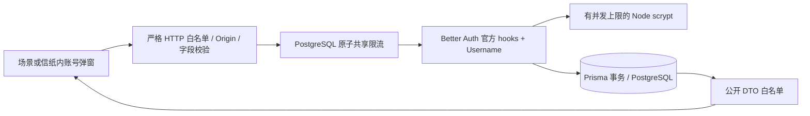
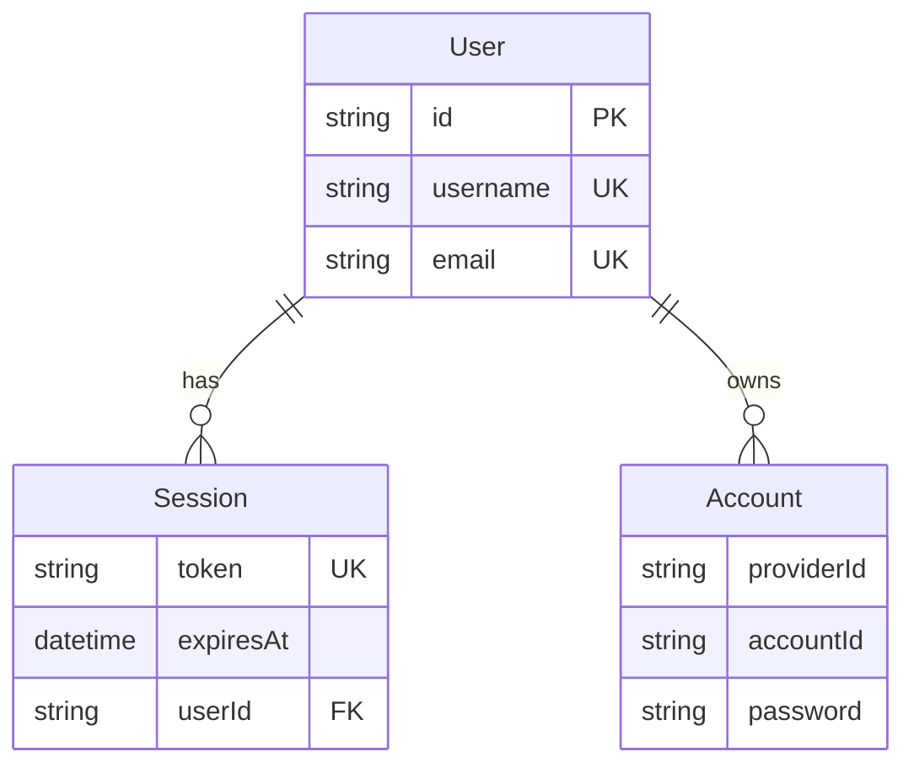

# P2-04 用户名认证

本分支实现 [Issue #15](https://github.com/SynapseOperator/mq-story-blog/issues/15)，负责人已验收的 [Spike #14](https://github.com/SynapseOperator/mq-story-blog/issues/14) completed 关闭。Better Auth **1.7.12** + Username，Prisma **7.10.1**、PostgreSQL **18.6**、Next **16.4.2**。这是正式项目集成，**尚未允许正式用户或生产开放**。

## 依赖与合并

从 P2-03 `d582cd780dd1c50a84403c2030cdfa4eda738c62` 创建 `feat/p2-04-username-auth`。Draft PR 的 base 为 `feat/p2-03-story-lifecycle`；[PR #13](https://github.com/SynapseOperator/mq-story-blog/pull/13) 未合并，没有 Review Exception。不能将故事领域代码描述为已经属于 main。

PR #13 获正式授权合并后，先核对 main 的真实 SHA/CI，再调整本 PR base；若依赖 squash 合并，谨慎处理重复提交，仅保留本增量，不修改历史迁移。重新执行空库全部迁移、schema diff、故事/认证集成、工程检查和浏览器回归，新的提交需要新的 Review/CI。当前不合并任一 PR，不开始 P2-05。

## 请求与数据路径



| 相对 `/api/auth` 路径 | 方法 | 输入/效果 |
|---|---|---|
| `/sign-up/email` | POST | **仅** `{username,password}`；名字中的 email 是框架兼容路径，客户端不能传 email |
| `/sign-in/username` | POST | 仅 `{username,password}`；成功后设置 HttpOnly Cookie |
| `/get-session` | GET | 无查询参数；返回 null 或 `{user:{id,username},session:{expiresAt}}` |
| `/sign-out` | POST | `{}`；删除当前数据库 Session 并清除 Cookie |

其他路径（包括邮箱登录/修改/验证/找回、用户更新、删除、OAuth、会话管理插件、管理员端点）一律拒绝；方法、查询参数、Content-Type、4096 字节请求体上限及额外字段均校验。API 不开放 Server Action 代理。官方 `hooks.before` 只在受保护 HTTP 边界中转换注册数据；认证对象保持模块私有。只读 `readSession(headers)` 可供未来服务器服务使用，不能把前端 session 状态当成服务端权限。

所有 POST 必须精确匹配配置 Origin，即使没有 Cookie；拒绝 cross-site Fetch Metadata。框架原有 CSRF/Origin 检查继续开启。响应显式挑选公开字段，不转发框架 token/email/name/image 等字段；错误只返回固定 code，不传递原始异常。设置 no-store，不跨域开放 CORS。官方 `onAPIError.throw` 阻止底层默认错误日志泄漏；自定义 logger 只写固定类别，不记录请求内容/驱动异常。

## 数据模型及数据库保证



新增 `202610230003_username_auth/migration.sql`，保留已有 foundation/story SQL 不变。

- `User.username` NOT NULL + UNIQUE + CHECK 小写 `[a-z0-9_]{3,32}`；服务端将 ASCII 大写转为小写。数据库唯一性解决并发同名竞争。
- `User.email` 是服务端随机 UUIDv4 `@accounts.invalid`，与用户名无关联；UNIQUE、格式 CHECK、不可变 UPDATE trigger；`emailVerified=false` CHECK。不发邮件、不承诺密码找回。
- `Account` 仅允许 credential，accountId=userId、密码非空且 OAuth token 为空；providerId/accountId 复合唯一，用户外键。公开接口不接受内部字段。
- 没有 role/admin/grant 列或管理员插件。P2-04 所有新用户只有普通身份，尚未具备管理员权限；P2-05 才设计唯一管理员授权，不以 `User.role UNIQUE` 代替唯一管理员约束。
- `Session` 有唯一 token、用户 FK、绝对过期时间；Cookie cache 关闭，每次读取检查数据库，默认 24 小时绝对有效、不自动续期。退出/删除 Session/过期后旧 Cookie 立即失效。后续受控管理服务可撤销记录，本轮没有无鉴权撤销 API。
- **Better Auth 默认 Session.token 在数据库中原值存储，本实现未改为哈希保存。** Cookie 签名、HttpOnly 与响应字段剔除不等于数据库 token 已哈希；DB/备份泄漏仍是关键风险。
- `Verification` 是框架兼容模型，当前无邮件功能且测试要求零记录。`RateLimit` 是框架第二道保守限流；`AuthRateLimit` 是项目共享原子窗口。
- 注册的 User/Account/Session 使用 Prisma adapter `transaction:true`；Account 或 Session 故障不能留下半个账号。没有修改故事/星位表或接入前端真实故事。

## 共享限流及代理契约

主限流使用 PostgreSQL `INSERT ... ON CONFLICT DO UPDATE`、固定顺序事务加锁、数据库时间及饱和计数，跨 Node 进程共用。每 60 秒注册与登录各自：用户名 8 次、客户端 20 次、全站 120 次；get-session/sign-out 客户端 240、全站 3000。所有尝试计数，不依赖仅成功请求；命中时返回 429 + Retry-After。全站桶先检查，限制攻击者创建任意用户名桶的数量。过期一小时的项目窗口在请求中清理；键为带服务端 secret 的 HMAC，不存原始用户名/IP/Cookie。阈值是当前可审查实现参数，正式开放前须结合容量与误伤测量调整。

框架第二道保护仍开启，使用 Better Auth **1.7.12 官方 `customStorage.consume(key, rule)`**，复用 `RateLimit` 表与现有迁移。一次 PostgreSQL UPSERT 在唯一键锁下决定是否放行和增加计数，替换原生存储的读取/创建/冲突重试路径；拒绝请求不延长窗口，保留框架“最后一次接受请求后的活动窗口”语义，与项目固定窗口区分。键同样 HMAC 化，官方支持的规则仍为每路径 60 秒 1000 次，不信任客户端 IP 头。第二次查询只计算拒绝后的 Retry-After，不参与放行决定。

故障分类以具体异常来源为依据，不能仅观察 503 + Retry-After：

| 响应 | 含义 |
|---|---|
| 429 `RATE_LIMITED` | 已确认额度耗尽 |
| 503 `AUTH_HASH_BUSY` | 密码执行队列抛出的明确容量异常 |
| 503 `AUTH_LIMITER_ERROR` | 项目或框架限流存储失败，关闭入口，不能计为正常限流或哈希饱和 |
| 503 `AUTH_STORAGE_UNAVAILABLE` | 已识别的数据库连接故障 |
| 503 `AUTH_UNAVAILABLE` | 认证配置不可用 |
| 500 `AUTH_INTERNAL_ERROR` | 其他内部错误；不附加猜测的 Retry-After |

应用日志只写对应固定类别，不序列化原始 Error；PostgreSQL 服务日志必须单独配置和审计，见 [日志复核](AUTH_LOGGING_REVIEW.md)。TERSE 不会清除驱动 Error DETAIL，也不能清除可能出现在主 ERROR 中的输入。

未配置代理时，**只允许 loopback 本地 Origin**，所有客户端归保守共享桶，完全忽略 X-Forwarded-For；不宣称已获得真实终端 IP。非本地 Origin 必须配置 `AUTH_PROXY_SECRET`，每次请求需携带可信入口覆写的 `x-mq-proxy-key` 和单一 `x-mq-client-ip`。入口从连接 socket 获取 IP，不使用客户端 XFF；密钥固定长度比较。IPv4 映射 IPv6 归一，IPv6 按 /64 合并，避免换写法/接口地址突破限流。

生产入口必须阻止绕过代理直连、删除/覆写这两个私有头、关闭含秘密请求头的访问日志；代理与应用之间使用受保护网络。此契约已由本地 HTTPS 反向代理试验覆盖，**没有选择或部署生产平台**。共享用户名桶可能被恶意消耗造成短时拒绝登录，仍需监测及独立安全审查；数据库/代理故障一律关闭认证入口，不降级为无限流。

## 密码与资源预算

框架内置 scrypt 默认 N=16384/r=16/p=1，检查点评估后未直接采用为正式成本。使用官方 `emailAndPassword.password.hash/verify` 扩展点调用 Node 原生异步 scrypt：**N=32768、r=8、p=3**，对应 OWASP 的 32MiB 档位；16 字节随机 salt、64 字节 key、timingSafeEqual。无 Argon2 或额外密码学依赖。

严格格式 `$mq-scrypt$v=1$N=32768,r=8,p=3$<salt>$<key>`，只执行代码固定成本，拒绝未知/损坏/更高成本编码，防止数据库成本字段触发资源失控。保留框架 NFKC 规范化，不 trim/截断；密码 12–128 UTF-16 code units，拒绝损坏代理项。后续若改变参数需新版本与显式迁移方案；Spike 合成账号不迁入。

每进程最多 2 个 scrypt 执行、4 个排队；单个工作区约32MiB，native maxmem48MiB，明确队列饱和返回503 `AUTH_HASH_BUSY` / Retry-After。全站共享限流再约束多实例请求量。副本数量/内存预算必须在部署前确定；此项不是压力测试或生产容量保证。

Windows 与 Linux 运行 `npm run test:auth:hash` 比较默认/正式成本与并发，不输出密码/hash/salt。Windows 初次测量平均默认 hash/verify 52.17/51.74ms，正式155.67/155.31ms；6任务通过2执行+4排队约480/489ms。机器差异与重复测量合理，CI/最新结果见 PR 证据，RSS 采样不冒充峰值。

## 本地运行及测试

普通 `npm run check` 不需要数据库或认证秘密；未配置认证时场景仍可阅读，账号入口提示服务不可用。

按 [DATABASE.md](DATABASE.md) 启动既有开发/测试实例。在确认当前分支后，开发者可执行 `npm run db:migrate` 应用增量（不会自动创建账号）。本轮自动验收只在测试实例的随机临时空库执行，不访问开发库故事。

```sh
npm run auth:env
npm run dev:auth
# 或 npm run build && npm run start:auth
```

`auth:env` 只以排他创建方式生成被忽略的 `.env.auth.local` 与随机认证 secret；存在则保留报错，绝不改写 `.env.db.local`。`dev:auth`/`start:auth` 内部读取已受保护的本地开发 DB URL，仅绑定127.0.0.1；默认 http://127.0.0.1:3000，不能与 localhost 混用。改端口需同时改本地 AUTH_ORIGIN。禁止上传本地 env、终端带秘密输出、浏览器存储及 TLS 私钥。

```sh
npm run check
npm run test:db
npm run test:auth:hash
# test:auth 使用已构建的 Next 应用
npm run test:auth
npm run test:auth:limiter
npm run test:auth:logs
```

认证 runner 只经项目 test URL 白名单，在测试实例创建 `mq_test_auth_<随机32hex>`；校验 PostgreSQL18/current_user，部署全部正式迁移并检查 schema drift，启动两个生产进程测试，结束后仅清理自己的进程/临时库。没有 SQLite/Mock、down -v、reset 或全局 prune。真实密码/secret/cookie 仅在内存，报告只有断言、次数和版本。CI 对 main 与 stacked base 的 PR 执行相同测试。

本轮审查保留 [Quality #20 原始记录](https://github.com/SynapseOperator/mq-story-blog/actions/runs/39988162531)：数据库日志有 29 条 `RateLimit_key_key` ERROR，以及两处 CHECK DETAIL 的合成内部邮箱。此前将 Linux 注册 burst 的单次泛化 503 归因为 scrypt 容量不足，**证据不足，撤回该归因**。历史响应没有错误来源分类，不能在事后确定原因。独立无哈希 HTTP/PG 对照稳定复现原生限流竞争，但框架能捕获并重试，低于额度的请求均成功，没有复现 503。

`node scripts/auth/rate-limit-regression.mjs` 默认重跑旧/新对照，故意在本次独立临时库制造旧实现冲突；原始脱敏结果保留在本机审查证据目录。CI 使用 `--custom-only`，验证冷键/热行竞争、拒绝不延长窗口与到期恢复，不重复制造旧错误。登录 burst 才用于实际验证 HTTP 哈希饱和；注册 hash 位于事务中，连接池限制可能使注册 burst 全部成功，不能以它证明队列曾达到容量。

补测 [Quality #21](https://github.com/SynapseOperator/mq-story-blog/actions/runs/39994562504) 和诊断 [Quality #22](https://github.com/SynapseOperator/mq-story-blog/actions/runs/39995353910) 保留失败记录。#22 的注册突发为 15 成功、5 个 500，固定类别确认这 5 个为 Prisma **P2028 事务错误**，不是 hash overflow；其余故障注入可区分。这不能追溯证明 #20 的历史 503 原因。独立真实 PG 探针占满3个连接，默认等待2秒时第四笔 P2028，3秒释放连接后等待预算5秒的客户端成功。

仅认证使用 `src/server/auth/database.ts` 专用客户端，将 Prisma 事务获取等待从默认2秒明确为 **5秒**，事务执行时限仍为 **5秒**；保留池大小3、驱动连接超时5秒与哈希/共享额度，不修改 P2-03 数据库工厂。使用 [Prisma 7 官方事务选项](https://www.prisma.io/docs/orm/v7/prisma-client/queries/transactions)，不重试非幂等注册或把事务错误转称容量拒绝。`npm run test:auth:transactions` 比较真实默认/认证客户端，并纳入 CI；20注册突发仍严格要求成功或已明确识别的哈希拒绝。此预算不保证无限负载成功，超预算的事务错误继续按内部错误处理，正式部署仍需容量验证。

## UI 与开放门槛

场景账号入口和信纸内账号窗口共用会话状态与原生 dialog。登录/注册不导航离开阅读器；取消/成功后保留文章、滚动、演示留言草稿。外层阅读规则、Logo/星位/动画/素材保持不变。登录不赋予真实点赞/评论能力，原有演示按钮仍明确为本地状态。用户名/密码要求与不提供找回在窗口中明确说明。

开放真实用户前仍必须完成：独立安全审查、应用数据库最小权限检查（运行身份不能沿用迁移/测试创建库身份）、正式 HTTPS/代理配置审查、备份及日志秘密保护、资源压力与限流误伤评估。P2-05 管理员及后续业务不属于本次范围。UI 产品验收待负责人；技术测试不替代视觉/交互审批。

官方依据（2026-10-23 核对，兼容性同时以安装的1.7.12源码和真实测试为准）：[Hooks](https://better-auth.com/docs/concepts/hooks)、[Options](https://better-auth.com/docs/reference/options)、[Prisma adapter](https://better-auth.com/docs/adapters/prisma)、[Username](https://better-auth.com/docs/plugins/username)、[Rate limit](https://better-auth.com/docs/concepts/rate-limit)、[Sessions](https://better-auth.com/docs/concepts/session-management)、[OWASP 密码存储](https://cheatsheetseries.owasp.org/cheatsheets/Password_Storage_Cheat_Sheet.html)、[Node scrypt](https://nodejs.org/docs/latest-v24.x/api/crypto.html#cryptoscryptpassword-salt-keylen-options-callback)。
