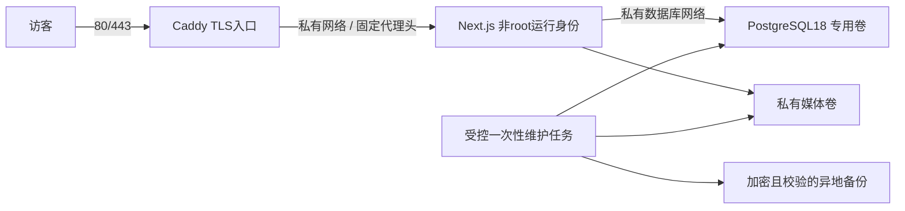

# P3-01 部署就绪审查

审查日期：2026-11-05。基线：`224eb14b2fdd8babc8df1d79e0bb6cedff4dc0cc`，对应 [Issue #47](https://github.com/SynapseOperator/mq-story-blog/issues/47)。本报告是检查结果和待批准方案，不是部署完成证明。依据 PRD v1.1 §03/08–11、FN-01/02/05–09/14/17/18 及课程原评分表。

**历史快照与后续落实**：本报告以下表格、统计、方案和验证记录保留 2026-11-05 的检查事实，不代表当前代码仍缺少所有列出的能力。后续 [PR #50](https://github.com/SynapseOperator/mq-story-blog/pull/50) 已交付生产身份、秘密、私有媒体与 Compose；[PR #52](https://github.com/SynapseOperator/mq-story-blog/pull/52) 已交付加密备份、完整隔离恢复、轮换和运维检查，两者均已合并。当前可执行合同见 [生产基础](PRODUCTION_FOUNDATION.md)、[备份恢复](PRODUCTION_BACKUP.md)、[秘密轮换](SECRET_ROTATION.md)和[主机运维](OPERATIONS_RUNBOOK.md)。Session 摘要候选仅完成 [兼容性实验](SESSION_TOKEN_SPIKE.md)，没有接入认证。负责人后来已购买 VPS，尚未连接或部署，实际规格待只读核验；以下“未购买”等表述保留当时状态。课程中的真实主机配置、生产部署与 CD 不因本地容器通过而计为完成；Projects/Iteration 与平台保护须另行实时核验。

**结论：建议首版采用单 Linux VPS + Docker Compose + Next.js + PostgreSQL 18 + Caddy + 私有媒体卷；目前不具备直接开放真实用户的条件。** Phase 2 功能和隔离测试已完成，生产运行身份、环境合同、主机入口、密钥/会话恢复和交付门禁仍有明确缺口。没有采购、部署、创建域名、生成生产凭据或修改业务代码。

## 已核实的状态

| 能力 | 已实现 | 已通过隔离测试的证据 | 尚未生产验证 |
| --- | --- | --- | --- |
| 业务与权限 | 故事版本/星位、认证、唯一管理员、媒体、发布、点赞、留言审核 | [main CI](https://github.com/SynapseOperator/mq-story-blog/actions/runs/41996598552) quality/database 全步骤成功；001→008、低权限、HTTP/HTTPS及生产构建浏览器 | 真实主机、流量、生产角色及数据 |
| 构建与CI | npm锁文件，Node24.19.0/npm11.17.0，固定Actions SHA，PR/main检查 | Linux191项单测零跳过、build、数据库与浏览器回归 | 没有Dockerfile、应用OCI镜像、生产Compose、Caddy配置、CD或已发布digest |
| 身份与签名 | withAdmin事务、数据库Session、006/008受限签名函数 | 伪造、重放、撤权、CAS、最小权限和恢复后发布/审核默认拒绝 | 完整生产provisioner、全部函数owner审计、轮换/恢复操作流程 |
| 私有文件与恢复 | 0700/0600、路径/链接拒绝、原子不覆盖、引用锁、联合备份清单 | Linux文件权限、缺失/篡改、随机新库恢复、公开/私有隔离 | 生产文件系统、磁盘硬配额、加密/签名/异地副本、定时恢复演练 |
| 网络安全 | Origin/CSRF、签名代理头、共享DB限流、受限解码与密码队列 | 临时HTTPS反向代理、Cookie、伪造来源、429/503 | Caddy及真实DNS/TLS、可信代理链、全入口资源限制与监控 |
| GitHub流程 | 真实Issue、PR、独立Review、普通merge记录 | #44/#46的review.commit_id匹配HEAD且CI通过 | **main protected=false**；Projects/Iteration未核实；没有部署环境/CD |

基线证据：[PR #44](https://github.com/SynapseOperator/mq-story-blog/pull/44)、[PR #46](https://github.com/SynapseOperator/mq-story-blog/pull/46)。已获产品验收不意味着生产渗透/配置安全审查完成。`npm audit --omit=dev --json` 本轮退出0、已知生产依赖告警为0；这只是当时registry结果，不证明没有未知漏洞，也未检查生产OS/镜像。

## 部署路线与资源

| 路线 | 对MQ的适配与成本 | 结论 |
| --- | --- | --- |
| 单Linux VPS / Compose | 复用持久私有文件、Sharp子进程、PostgreSQL原生函数和短维护窗口；能直接留存主机、防火墙、部署、恢复证据。需自行补丁、监控、备份，单机故障会停站 | 推荐首版；不引入微服务、Kubernetes或消息队列 |
| Vercel + 托管PG + 私有对象存储 | 减少主机运维，但现有本地存储、子进程预算、维护命令、备份及受限owner需适配；托管PG须验证扩展/角色权限。费用按实际用量另审 | 保留替代，不在本轮采购或迁移；教师是否认可托管平台等价“主机配置”仍需确认 |

Vercel Functions 文件系统不能作为持久照片库；3MiB上传本身低于其4.5MB请求上限，不能把这个上限当作否定Vercel的理由。真正改动是持久私有存储、请求/worker生命周期、权限和恢复。即使采用对象存储，也保持bucket私有、应用按当前公开Revision授权，不设置永久公开URL。[Vercel运行环境](https://vercel.com/docs/functions/runtimes)、[限制](https://vercel.com/docs/functions/limitations)。

建议起始评估：**2 vCPU、4GiB RAM、60–80GiB SSD**，镜像在CI构建，VPS仅运行一个Node进程。可先以app 1.5GiB、PG 768MiB、Caddy 128MiB作为压力测试预算，保留OS、备份与缓存余量；这些是估算，不是已压测容量承诺。同机同时运行两套环境建议重新评估到8GiB，不能共享数据库/媒体/密钥。

备份建议另留至少20GiB受控空间，并准备不在同台VPS上的加密副本。容量按 `保留份数 × (数据库归档 + 私有图片 + 清单) + 两份恢复/打包工作空间 + 20%余量` 测算，不能只看图片软额度。初步可讨论每日7份、每周4份、每月3份及RPO24小时/RTO2小时；周期和目标均待负责人批准与计时演练，当前逻辑备份没有PITR。

仅Caddy的80/443对外；SSH仅VPN或固定管理来源。3000、5432、Caddy管理API及Docker socket不对外，应用/反代不得挂载Docker socket。Caddy不挂载照片、DB或备份卷；PG18挂载`/var/lib/postgresql`，不沿用旧版本数据卷路径。私有媒体位于应用根目录之外，例如`/var/lib/mq/media`，固定UID、0700目录/0600文件，目标文件系统必须支持当前原子hard-link操作。

## 环境变量与默认开关

以下来自`src/server`/`src/app`的实际读取，不包含任何值或本地`.env`内容。当前没有业务`NEXT_PUBLIC_*`配置；秘密不得经此类变量进入客户端。Next的公开变量会在build时内联，[官方说明](https://nextjs.org/docs/app/guides/self-hosting)。

| 配置 | 当前行为 / 默认 | 生产处置 |
| --- | --- | --- |
| `DATABASE_URL` | 无值时公开故事不可用；构建可不连接DB | 仅app受限身份，不能用迁移账号；由运行时注入 |
| `MQ_AUTH_ENABLED` | 仅字符串`true`启用，否则拒绝认证 | 同时影响用户名注册/登录；没有独立的生产注册白名单开关，Staging必须有外部访问门禁 |
| `AUTH_ORIGIN` | 无有效值即拒绝；单一规范origin | 固定批准的HTTPS域名，不从客户端Host推导 |
| `AUTH_SECRET` | 至少32字符，当前单实例配置缓存 | 独立CSPRNG秘密，不复用发布/审核/代理密钥；轮换须重启全部实例 |
| `AUTH_ALLOW_LOCAL_HTTP` | 仅显式true且loopback允许HTTP | 生产关闭，不能关闭Secure Cookie来通过测试 |
| `AUTH_PROXY_SECRET` | 非本地origin必须存在，至少32字符 | 由Caddy覆盖注入`x-mq-proxy-key`，用真实连接IP生成`x-mq-client-ip` |
| `MQ_MEDIA_ENABLED` | 非true拒绝媒体接口 | 生产环境合同与私有卷验证后才可启用 |
| `MQ_MEDIA_ENV` | **只接受development/test** | 没有生产模式，须新增明确staging/production合同；不能伪装development |
| `MQ_MEDIA_DEVELOPMENT_ROOT` / `MQ_MEDIA_TEST_ROOT` | 必须绝对、独立、非嵌套、在项目目录外 | 目前为本地/测试根，不直接作为生产卷配置 |
| `MQ_PUBLISH_ENABLED` / `MQ_PUBLISH_SIGNING_KEY` | 仅true且64位小写hex独立密钥；缺失拒绝发布 | app与私有Schema一致配置；不在006里生成密钥 |
| `MQ_COMMENTS_ENABLED` / `MQ_COMMENT_SIGNING_KEY` | 写入默认关；审核需另一独立64位hex密钥 | 不复用发布或认证密钥；公开已审核列表GET不依赖写开关 |
| `BETTER_AUTH_SECRET` / `MQ_AUTH_SECRET` | MQ只在防密钥复用校验中引用，不能代替`AUTH_SECRET` | 不作为第二套配置入口；白名单拒绝意外继承的框架别名 |
| `BETTER_AUTH_SECRETS` | 锁定BA内部仍可读取多密钥配置；MQ未采用其轮换合同 | 不意外注入；如采用必须单独验证Cookie和加密语义，它不是token哈希开关 |
| `NODE_ENV` / `PORT` / `HOSTNAME` | Node/Next运行参数 | production，容器内3000/0.0.0.0但不发布宿主端口；框架变量与秘密分离 |

点赞没有独立启用开关，写入依赖有效认证；公开读库不是“全站关闭”开关。所有业务开关关闭也不等于Staging私密，仍需入口访问控制。

运维变量只交给对应一次性任务：`MQ_ADMIN_MAINTENANCE_DATABASE_URL`、`MQ_MEDIA_MAINTENANCE_DATABASE_URL`、`MQ_LIKES_PROVISION_DATABASE_URL`、`MQ_PUBLISH_PROVISION_DATABASE_URL`；备份的`MQ_MEDIA_BACKUP_DATABASE_URL/PARENT/DIRECTORY`与恢复的`MQ_MEDIA_RESTORE_CONTROL_URL/PARENT`；`MQ_PG_TOOLS_CONTAINER`用于受控工具容器。`MQ_DEV_PASSWORD`、`MQ_TEST_PASSWORD`、`TEST_DATABASE_URL`属于开发/测试。证据路径、测试barrier等变量不进入生产白名单。

当前应用读取env，**没有通用`*_FILE`秘密载入支持**。拟议P3-02提供启动边界的文件秘密读取/验证，再用Compose按服务挂载只读secret文件；Compose文件挂载不等于加密vault，宿主机root和Docker权限仍是信任边界。[Compose secrets](https://docs.docker.com/compose/how-tos/use-secrets/)。禁止构建参数、镜像层、Git、CI日志、备份Artifacts携带秘密；不把整个维护环境传给app或图片worker。

## 阻塞项与安全整改

以下“高”表示正式开放或自动生产部署前必须处置；不是宣称当前隔离实现存在可直接利用的漏洞。

| 等级 | 实际缺口 / 代码接点 | P3-02验收出口 |
| --- | --- | --- |
| 高 | [`scripts/publishing/privileges.mjs`](../../scripts/publishing/privileges.mjs)、[`scripts/comments/privileges.mjs`](../../scripts/comments/privileges.mjs)限定随机测试库；004函数owner未由现有admin provisioner统一重设 | 新的显式生产目标/角色合同；迁移、app、维护、备份、NOLOGIN owner分离；拒绝错误DB/过大权限；真实低权限全套回归 |
| 高 | [`local-store.ts`](../../src/server/media/local-store.ts)及迁移/备份wrapper限定dev/test/loopback；restore只进随机测试库，CLI需TTY | 独立受控生产运维入口，不删除旧保护；私有DNS/同机维护连接的认证目标校验、幂等及失败拒绝 |
| 高 | Session.token原值、备份含会话/私有密钥；缺生产轮换及灾备重新开放流程 | 下述token兼容Spike与风险处置决定；恢复撤会话/轮换密钥/重配owner、旧Cookie与旧签名失效验证 |
| 高 | 现有HTTPS测试代理不是Caddy；`next.config.ts`的统一私有安全头只匹配`/admin/stories` | 所有管理页/敏感API头策略、真实代理链、Host/Origin、伪造IP与代理头、TLS续期及直接3000绕过测试 |
| 高 | 无生产镜像/卷/健康检查/CD；main当前无平台强制保护 | P3-03构建与运行验收；独立审批及部署门禁方案确认，不能将main push自动当作生产批准 |
| 高 | 备份仅完整性校验，未加密/签名/异地保存；恢复保留旧Session和两类私有签名key | 加密与真实性校验、独立密钥保管、离机恢复计时；恢复后默认关闭并撤旧会话/密钥 |
| 高 | Sharp的96MiB限制是V8 heap，不覆盖native RSS；app软配额不是磁盘硬配额 | Linux cgroup内存/CPU/PID及磁盘配额/低水位；压力、OOM、磁盘满和恢复测试，不关闭OOM保护 |
| 中 | 没有全入口边缘请求/连接预算和集中告警；现有限流针对具体业务 | 超限413/429/503区分、慢请求/并发/公共GET预算、日志脱敏与轮转、告警和维护手册 |
| 中 | 当前总素材记录1000、READY/PENDING预留256MiB、每小时30、PENDING4 | 记录真实容量，FAILED/DELETED也计入总数，删除不释放名额；不无依据放大阈值 |

### 数据库身份

- `app_runtime`：仅现有列级DML和受控函数EXECUTE，不拥有对象、角色成员关系或DDL，不读签名私有表，不直接改管理员授权、公开Revision、发布状态或星位。
- 迁移登录：只在维护窗口执行已审核新增迁移，拥有/可切换专用schema owner；不挂载到app。现有dev/test `npm run db:migrate`不能直接当生产CD。
- 管理员维护登录：仅授权/撤销/重置所需列与受控函数，TTY隐藏密码、明确目标及expectedVersion；不授予通用迁移权。创建真实管理员仍需另行批准。
- 函数所有者：不可登录、固定可信search_path、撤PUBLIC EXECUTE、最小表/列权限。逐项审查004、005、006、007、008中的全部11个SECURITY DEFINER；当前显式受限owner配置只覆盖发布与审核两个apply函数，其余实际owner仍需在目标数据库核实，不能推断已完成生产配置。
- 备份/恢复身份：不提供给app；dump单库不包含集群角色，恢复时重新执行受审角色配置。受控恢复可能需要创建新库，权力只存在于离线维护窗口。[PostgreSQL pg_dump](https://www.postgresql.org/docs/18/app-pgdump.html)。

函数清单：004为`mq_admin_grant_audit`、`mq_admin_credential_lock`、`mq_admin_credential_audit`、`mq_lock_admin_access`、`mq_lock_admin_credentials`；005为`mq_project_revision_assets`；006为`mq_apply_story_publication`；007为`mq_lock_story_like_access`；008为`mq_lock_comment_context`、`mq_guard_story_comment`、`mq_apply_comment_moderation`。owner与EXECUTE审查必须覆盖触发器调用链，不能只看HTTP直接调用的函数。

### Session Token与签名密钥

锁定Better Auth1.7.12在`internal-adapter`生成token后原值入库，按token查询；MQ的`Session.token`唯一约束没有哈希。Cookie对token签名，cookie session cache关闭。因此DB只读泄漏并不自动赋予伪造Cookie能力（还需签名秘密或有效Cookie），但会暴露会话凭据并放大与app秘密/备份泄漏组合的影响；数据库写或app被攻陷不由token哈希解决。

优先做小型官方adapter扩展验证：客户端持有随机原token、DB保存单向摘要，服务端仅在请求处理中短暂处理原token；覆盖create/find/update/delete、联表、事务、到期、退出、撤权和维护重置。不能只在create hook中哈希，否则可能将摘要发回Cookie或使查找/撤销失配。业务权限和HMAC绑定的是Session.id，不应改签名协议；相关低权限与恢复测试仍须重跑。若官方扩展无法可靠适配，停止该方案并比较兼容路径；风险未处置前不声称可开放。现有框架多secret能力不是现成token哈希开关。[BA配置](https://www.better-auth.com/docs/reference/options)、[安全说明](https://www.better-auth.com/docs/reference/security)。

发布和审核各用独立CSPRNG 32字节密钥，不复用AUTH/代理secret。应用从独立运行时秘密配置获取密钥；数据库仅授权受限函数owner读取对应私有Schema的密钥表，app_runtime不得直接读取。首版轮换建议短维护窗口：关闭写入口→排空事务→受控更新DB和应用秘密→重启所有实例→验证新key成功、旧key/参数替换/重放失败→显式开放。当前没有已验证的key-id双密钥无停机轮换，不提前引入复杂协议。

恢复不是重新开放授权：恢复副本含旧Session及006/008秘密，先隔离网络、关闭开关，撤销全部旧Session、轮换认证/代理/发布/审核secret、重配NOLOGIN owners和列级权限，再验证旧Cookie/旧签名失败。AUTH_SECRET单例缓存需重启；不要以后恢复旧secret让历史Cookie重新有效。重置/撤权审计仅识别共享管理员账号，不能追溯到两位真人中的某一位。

### HTTPS、入口与资源

Caddy首版直接面对客户端，不默认信任任意X-Forwarded-For。丢弃并覆盖所有客户端`x-mq-*`头，注入固定代理秘密和由真实连接产生的IP；若以后加CDN，只信任明确CIDR并重验完整链。`AUTH_ORIGIN`与HTTPS域名一致，保留CSRF/Origin和Secure/HttpOnly Cookie。受保护图片继续no-store，无304/共享优化缓存，HEAD也验权。[Caddy反代](https://caddyserver.com/docs/caddyfile/directives/reverse_proxy)、[自动HTTPS](https://caddyserver.com/docs/quick-starts/reverse-proxy)。

在入口限制请求体、头、连接和读写时间，媒体原始字节最多3MiB、认证JSON4KiB、留言JSON8KiB按路由分别配置并测试chunked请求；不能把全站阈值错误设为4KiB。继续复用PostgreSQL原子限流，补公共读取等入口预算。Caddy官方列出的`rate_limit`是非标准模块，不能写成默认自带；若确需模块，单独审查来源/版本或选择受控外层方案，不为简单博客新增无必要平台。[请求体限制](https://caddyserver.com/docs/caddyfile/directives/request_body)、[非标准限流模块](https://caddyserver.com/docs/json/apps/http/servers/routes/handle/rate_limit)。

当前scrypt为N32768/r8/p3、maxmem48MiB、2执行+4排队；Sharp为2执行+2排队、12秒、24MP。密码成本和图像native内存须在选定VPS上压测。日志不记Cookie、代理秘密、签名、原IP或正文；数据库沿用terse/禁参数错误日志，代理/容器日志另审查，不能只检查应用console。日志轮转和安全审计保留期由负责人确认。[Docker资源限制](https://docs.docker.com/engine/containers/resource_constraints/)、[Sharp缓存/并发](https://sharp.pixelplumbing.com/api-utility/)。

## P3-03 交付、Staging与回滚方案

1. **镜像构建**：Linux多阶段构建、固定基础镜像digest、Node/npm/lockfile、`npm ci`、Prisma generate；计划启用standalone并显式带入public、.next/static、Sharp worker与native库，实际从干净镜像启动上传/读图验证。迁移/维护工具放独立构建target。非root、最小可写目录、无源码.env/备份；新增.dockerignore；构建不接生产DB。当前没有这些产物。[Next standalone](https://nextjs.org/docs/app/api-reference/config/next-config-js/output)。
2. **CI产物**：保留现有全部quality/database后构建镜像，记录commit、迁移清单校验和、digest、SBOM和扫描结果；拟用私有GHCR，先核实配额，不默认付费。Actions锁SHA，PR不拿部署秘密，packages写权限仅给发布Job。构建过程可重复、镜像按digest晋级，不声称已经验证字节级可复现；不在VPS重建或用latest决定版本。[GitHub镜像发布](https://docs.github.com/en/actions/tutorials/publish-packages/publish-docker-images)。
3. **门禁**：当前main不受平台保护，不能直接push触发生产。先解决私有仓库保护能力；GitHub私有Environment required reviewers另有套餐限制，不能因有Pro就承诺可用。若缺平台批准门禁，自动流程先止于合成Staging/镜像，生产由负责人核对受审digest后执行受限维护命令；workflow_dispatch不冒充独立部署审批。本轮不升级套餐或改public。[分支保护](https://docs.github.com/en/repositories/configuring-branches-and-merges-in-your-repository/managing-protected-branches/about-protected-branches)、[Environments限制](https://docs.github.com/en/actions/how-tos/deploy/configure-and-manage-deployments/manage-environments)。
4. **受控Staging**：首台主机先只运行合成数据环境，通过VPN/来源白名单限制访问，noindex只是补充。独立库、卷、secret、origin，绝不复制生产dump。先空库001→008，再旧版本合成快照升级，角色审计、真实Caddy HTTPS、注册/会话、发布/媒体GET/HEAD、匿名/账号留言审核、浏览器、OOM/磁盘满、恢复和回滚都留真实证据。运行开关只在该受控环境启用；正式数据环境必须另建。
5. **部署**：串行部署锁→核验digest/迁移兼容性/磁盘→维护页并停止app/worker写入→处理PENDING/DELETING→联合备份验证→迁移身份`migrate deploy`等价受控执行→角色/owner/权限后置验证→候选镜像私网健康及核心读写检查→切换→记录结果。失败保持维护状态，不绕过权限，不用生产容器跑任意PR或自托管CI runner。
6. **回滚**：只在已证明兼容当前Schema、v1/v2、权限与密钥配置时切回上一digest；新增迁移不修改历史001–008，不自动down/reset。破坏性变更先扩展后收缩；不可兼容时优先向前修复。恢复备份是独立灾备流程，会丢失快照之后的数据，须明确负责人确认的RPO，不等同于换旧镜像。
7. **备份与监控**：现有导出快照+媒体锁/清单/COMPLETE验证作为基础；生产入口另行实现，不删除TTY与测试目标保护。先停止写入，等待并受控恢复PENDING/DELETING，不删除记录或强制改为READY；备份后加密、验证真实性、离机保存；备份密钥单独保存不与备份同盘。归档当前上限512MiB、清单10000项及4MiB读取上限需容量预检，超限应失败而非输出“完整”。监控磁盘/WAL、内存、DB连接、5xx/429、证书续期、备份年龄；定期随机新库/新目录恢复并测RTO，不自动清理未知文件或仍被历史Revision引用的图片。

## 课程证据

以下是证据覆盖，不是教师评分。2026-11-05只读查询时：25个Issue（24 closed、#47 open）、22个PR已merged、main73个commit；Issue实际assignee仅2项、label16项，milestone为0。快照之后本P3-01 PR会增加总数，不据此回填历史。

| 原评分项 | 实际证据 | 尚缺 |
| --- | --- | --- |
| 项目规划5% | PRD、历史DELIVERY_PHASES、[#1](https://github.com/SynapseOperator/mq-story-blog/issues/1)及分阶段工作项 | Projects Roadmap未核实 |
| 工作项设置5% | 真实Issue范围/验收，例如[#43](https://github.com/SynapseOperator/mq-story-blog/issues/43)、[#45](https://github.com/SynapseOperator/mq-story-blog/issues/45) | 负责人/标签字段未覆盖全部Issue；优先级与父子层级字段尚未核实，正文不等于字段 |
| 迭代5% | Issue/PR真实时间线 | **Projects Iteration未核实**；普通Issue和milestone不能冒充Iteration |
| 开发提交5% | 73个main commit及功能分支，例如[8479304](https://github.com/SynapseOperator/mq-story-blog/commit/84793043e741b0da0fbc7865a53506987b9e3a3f) | 最终按真实贡献整理过程报告 |
| 代码检查5% | lint/typecheck/unit及独立Review | Next专用/JSX可访问性规则是历史已记缺口；生产安全审查另做 |
| 构建配置6% | 锁文件、固定Node/npm、CI build | OCI镜像、digest、SBOM/可交付产物未有证据；当前Artifacts列表为0 |
| 持续集成5% | [Quality](https://github.com/SynapseOperator/mq-story-blog/actions/workflows/ci.yml)自动PR/main，真实DB/HTTP/浏览器 | 现有证据充分证明CI，不代表CD |
| 主机配置6% | 本地Docker/WSL及CI临时环境 | 无真实VPS的OS/网络/权限/容量验收；托管平台等价评分需教师确认 |
| 部署配置8% | 开发Compose及本设计 | environments=0、deployments=[]，无真实TLS域名/升级/回滚证据 |
| 分支合并5% | 22个合并PR；[#44独立审批](https://github.com/SynapseOperator/mq-story-blog/pull/44#pullrequestreview-5780507078)、[#46独立审批](https://github.com/SynapseOperator/mq-story-blog/pull/46#pullrequestreview-5781655830)匹配HEAD | **main protected=false**；#9/#11历史例外仍按真实记录保留 |
| 持续交付5% | 现有CI可作为前置 | 只有Quality，无CD工作流、镜像发布、环境晋级或回滚记录；当前releases=[] |

Projects通过`gh project list --owner SynapseOperator --format json`和repository projectsV2查询均因缺`read:project`失败，插件无对应能力，因此**不能说不存在，也不能说已创建**。需要负责人补充只读授权或提供可访问Project后再核实；创建/编辑另需写权限。只规划未来真实迭代，不补造Phase1/2历史。

`branches/main`实时返回`protected:false`；protection/rulesets接口403提示私有仓库需支持套餐，未升级、未改仓库可见性。独立Review的实际协作证据与平台强制执行应分别描述。课程25%过程总结、15%反思尚需真实终稿；本轮未确认其已完成。

## 建议的少量工作项与待决定项

只创建P3-01本项，以下不是已创建Issue或编码授权：

| 建议增量 | 范围 | 核心验收 |
| --- | --- | --- |
| P3-02A 生产身份与环境边界 | 显式生产/维护目标，角色/owner配置，媒体根与秘密文件合同 | 错误目标拒绝、运行身份无法直接发布/审核/提权、空库/升级和全部既有回归 |
| P3-02B 会话、密钥与入口安全 | token adapter兼容Spike、受控轮换/恢复、代理/安全头/限流与资源预算 | 旧会话/证明失效、官方扩展可用、真实Caddy伪造头/跨站/OOM测试；独立安全Review |
| P3-03A 镜像与受控Staging | Dockerfile/Compose/Caddy、固定digest、访问门禁、合成全流程 | 从干净镜像可运行、无秘密入层、真实HTTPS/功能/权限证据；无真实用户 |
| P3-03B 交付与恢复演练 | 门禁、迁移兼容、备份加密/异地、升级/回滚、课程证据 | 失败部署不开放、恢复校验及RPO/RTO实测、可核查部署/CD记录 |

负责人需确认：①接受VPS首版路线及未来预算/地区，教师对主机配置的验收口径；②私有仓库分支保护与部署审批能力如何取得（不默认购买），Projects只读授权；③备份保留周期、异地保存位置与RPO/RTO目标。Session整改先验证再选定，不在本报告冻结未验证的认证变更。

真正开放前：上述高风险缺口有验证证据、匹配最新提交的独立Review、生产配置/权限独立安全审查、可信HTTPS和访问门禁、备份恢复演练、负责人对真实内容及开放开关的明确批准。测试数量不能代替这些门槛。

## 本轮执行边界与验证

P3-01只修改过时CI base过滤和文档，保留全部Job、测试、权限、历史迁移与UI。实际核查使用GitHub只读API/gh、源码与锁定依赖、当前官方文档；没有读取或输出本地秘密值，没有创建生产数据、凭据、主机或域名。

Windows / Node24.19.0 / npm11.17.0：`npm run check`退出0，lint、Schema、typecheck和生产构建通过；191项单测中189通过、0失败、2项受平台限制跳过（文件symlink创建权限、POSIX 0700/0600），Linux CI保留这两项。现有Node MODULE_TYPELESS_PACKAGE_JSON警告未在文档任务中修改包配置。`git diff --check`与本次文档相对链接检查通过，`npm audit --omit=dev --json`退出0、已知告警0。本机未重跑数据库/浏览器套件；完整Linux回归由本PR原有CI执行并记录结果。

本PR CI结果记录在对应PR；本报告中的资源预算、容器化、生产角色、Staging/CD、token整改与备份策略均为待批准方案，不标记为测试通过。
