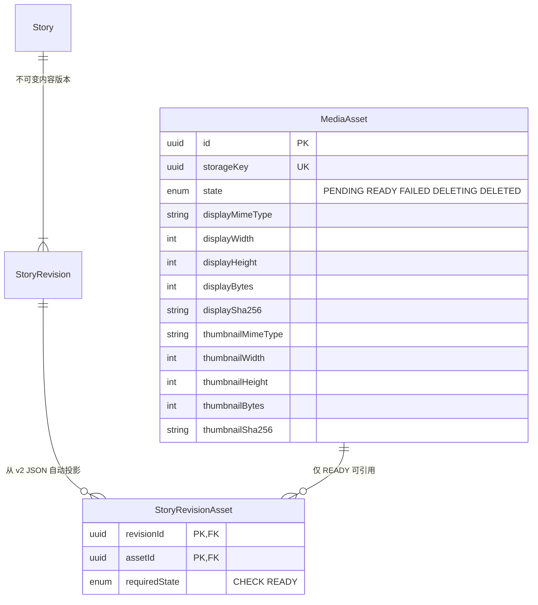

# P2-09A：私有媒体与 Revision 引用基础

关联 [Issue #29](https://github.com/SynapseOperator/mq-story-blog/issues/29)，对应 PRD v1.1 §02、§10、图片失败/公开隐私/数据可靠性及 FN-08/10/15/18。这里只交付数据与存储基础，不等同于完整图片管理或发布验收。

## 基线与已批准参数

本分支直接来自 main `42ef1821dd03881388f0bcc14c288a89a2e3dbe3`。PR #24（1f89837）、#26（3f161bf）、#28（5249c39）未合并，既有历史 APPROVED 不替代最新提交的正式 Review。本轮不改 base、不合并、不使用 Review Exception。

负责人已批准未来输入 JPEG/PNG/静态 WebP，最多 3 MiB、2400 万像素；约 1920px 最长边展示图、400px 缩略图，不长期保留原图，允许管理员显式跨故事复用。P2-09A 不接收用户上传、不解码或去 EXIF，也不声称已验证这些上传参数。这里的本地存储只接受后续可信处理器生成的派生字节；两种派生格式约定 WebP。

## 数据模型与约束



新迁移 `202611030005_media_foundation` 追加在 001→004 之后，不修改历史 SQL 或历史 Revision。Prisma 表达枚举、字段、唯一键及复合外键；原生 SQL 表达内容校验、状态/身份不可变、投影及权限控制，不能用 Prisma drift 通过代替原生行为测试。

v1 的历史包络与现有服务保持原样。v2 是 `{version:2,blocks:[...]}`：段落支持 text 与 normal/emphasis/strong，图片仅支持 assetId、alt、可选 caption。禁止 src、存储 Key、任意 URL 或未知字段；无对外 v2 写入口。每篇修订内同一 assetId 去重生成关联，不同修订/故事可共享资产。v2 限 1–200 块，段落 10,000 字符、alt 300、caption 1,000；总量采用 PostgreSQL `jsonb::text` 的 256 KiB 保守上限（包括规范化空格），后续请求校验需对齐，不能直接当作 JSON.stringify 字节数。

| 数据库保证 | 机制 |
| --- | --- |
| 素材身份及文件内容身份不能覆盖 | id/storageKey/创建时间稳定，READY 元数据与 SHA-256 后续不可变 |
| 只能引用 READY 素材 | `(assetId, requiredState=READY)` 复合 FK 引用 `(MediaAsset.id,state)`；关联常量 CHECK |
| 任何历史引用都阻止删除状态转换 | FK `RESTRICT` 保留引用，READY→DELETING 更改被引用键，使用 PostgreSQL 原生键锁与冲突检查 |
| 不能给历史公开 Revision 后补私人图 | INSERT Revision 自动从 v2 JSON 投影；关联不能任意追加、更新、删除或 TRUNCATE |
| 引用与 Revision 同事务 | 投影失败或外层 CAS 失败时 Revision/关联一起回滚 |
| 状态单向 | PENDING→READY/FAILED/DELETING；READY/FAILED→DELETING；DELETING→DELETED，不能复活或原位替换 |

没有 isPublic、引用计数或上传即公开行为。删除状态仅是数据约束，不提供删除服务/API/清理任务。物理文件存在、校验和是否与文件实际匹配、图片能否安全解码不能由 PostgreSQL 判断；未来可信处理流程负责这些事实，不能直接相信客户端 finalize 元数据。

投影 SECURITY DEFINER 只处理触发它的 Revision，固定 search_path、全限定表名，撤销 PUBLIC 的函数访问；不提供客户端可调用的任意 revisionId/assetId 关联函数。运行时不拥有函数/表、不获关联 DML 或管理员/发布列权限。迁移身份拥有 DDL，不能把它的能力称为生产最小权限；真实生产角色配置仍需独立批准与验证。

## 私有本地存储

`src/server/media/local-store.ts` 只提供派生文件写入/读取：服务端显式指定项目根、相互隔离的开发/测试私有目录与容量限制；拒绝项目内或其祖先路径，无 cwd/public 回退。目录需先由操作者建立。

Key 为 UUID，只允许固定 display/thumbnail 名称，不接受客户端路径、URL 或 original 变体。文件发布不覆盖既有内容；失败只清理本次产生的临时文件，不提供全局或递归清理 API。write 返回 byteLength，元数据 SHA-256 由后续可信处理器计算，不声称当前存储接口已经计算或验证摘要。若文件已发布后清理临时文件失败，可能留下未登记成品；后续恢复/孤立资源清理需处理，不能盲目重写同一 Key。测试使用独立系统临时目录，不接触开发媒体或真实照片。

普通符号链接、Windows junction 与路径逃逸拒绝；POSIX 目录/文件权限限制为 0700/0600。Windows ACL 由运行身份和目录配置承担，不声称 chmod 在 Windows 上完成隔离；不防御已控制同一 OS 身份的恶意进程并发替换目录，也不引入注册表/系统设置修改。没有静态映射或公开 URL。

所有文件 I/O 在短数据库事务之外。后续上传必须分成授权预留、事务外检测/处理/写文件、再次 withAdmin 完成 READY；本轮不新增编排流程、不持有管理员锁等待文件操作。

## 与 P2-08 和公开读取的接点

1. #24 正式集成后，使用其 `createStoryOperations(tx)` 在 withAdmin 同一事务写 v2 Revision；005 自动维护引用，不再增加第二套投影实现。现有 CAS/回滚逻辑保留。
2. main 目前的 `validateStoryContent`、公开 DTO 和 FeatherLetter 仍为 v1；本轮不将 assetId 转成 URL、不向其灌入私人素材。v2 的公开正文读取会安全失败，不声称完成图片交付。
3. #26/#28 的编辑快照需在后续增量适配 assetId；旧 v1 文章保存为新 v2 Revision，不回写旧版本。既有合成图需明确白名单映射，不能默许任意 src 绕过媒体模型。
4. 后续图片 HTTP 必须同时检查当前 PUBLISHED、所属 publishedRevision 的实际引用及 READY。下架后新请求拒绝，HEAD/条件请求/304/缩略图和 Next 图片优化路径不能绕过。P2-09A 无这些接口，尚未完成该验收。
5. P2-10 才接入发布/恢复前的资产可用性检查。外部存储不能与 PostgreSQL 普通事务原子提交，不承诺数据库能保证文件永远在线。

后续合并需特别处理 package.json、CI、README/AGENTS 与 P2-08 文档冲突；保留 media/story/auth/admin/public/sharing 以及未来 admin-drafts/editor/preview 全部测试。不能直接把现有未合并功能复制到 main 或声称联合验收已通过。

## 验证

```sh
npm run check
npm run test:media
npm run test:db
npm run test:auth
npm run test:admin
npm run test:public
```

媒体 runner 在测试实例创建自己的随机空库与临时角色：一个从空库部署全部迁移，另一个先通过原字节复制的 001→004 正式迁移建库、写合成 v1，然后升级 005；核对原内容和历史 checksum，重复 deploy 及 Prisma drift。真实两个事务以数据库锁观测协调，验证引用先行/删除先行两种顺序、CAS 败者与强制失败回滚；不以等待固定毫秒数代替锁证据。

临时 runtime 只获测试所需列权限，关联 DML/DDL/发布列和管理授权写权限均拒绝；该 fixture 不配置生产账号。测试只清理本轮命名的数据库、角色与目录，不清空 mq_test 或开发库。应用/数据库错误只报告固定阶段/类别，不打印 Key、连接串、内容、密码或原始数据库 DETAIL。

2026-11-03 Windows 本机：Node 24.19.0、npm 11.17.0、Prisma 7.10.1、PostgreSQL 18.6。最终退出码均为 0：

| 命令 | 实际范围 |
| --- | --- |
| npm run check | lint、Schema、typecheck、生产构建；73 个单元用例中 71 通过、2 明确平台跳过 |
| npm run test:media | 13/13 真实数据库组；空库、004 升级、drift、最小权限及并发锁 |
| npm run test:db | 31 个故事领域、约束及迁移检查 |
| npm run test:auth | 35 HTTP + 8 证书验证 HTTPS |
| npm run test:admin | 3 CLI 身份 + 18 DB + 20 HTTP + 4 HTTPS |
| npm run test:public | 15 公开读取 + 10 分享 HTTP/数据库检查 |
| test:auth:limiter / transactions / logs | 真实共享限流、事务等待与数据库日志保护/负控制回归 |

存储单元的两项 Windows 跳过分别为需要特权的文件 symlink 和仅适用于 POSIX 的 mode；Windows 目录 junction 用例实际通过。Linux CI 须验证其余平台分支。首次媒体测试错误（RESTRICT SQLSTATE 误认、预期键序未排序）及管理员迁移列表仍只列 001–004 的失败日志保留；仅纠正测试断言，未放宽数据库约束或减少既有测试。管理员 runner 现精确核对 001–005。

GitHub CI 结果链接在本 PR。没有完成的 HTTP/解码/UI/编辑器联合验收须明确标注；本轮没有浏览器视觉改动或新的视觉签收。没有运行 P2-08 未合并分支套件，不将其称为已完成联合验收。本轮不自动合并，不开始 B/C/D，不创建真实管理员或私人照片。
