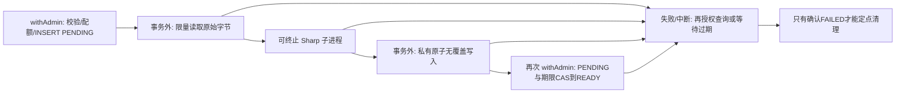

# P2-09B：安全上传与管理员私有素材读取

关联 [Issue #31](https://github.com/SynapseOperator/mq-story-blog/issues/31)。PRD v1.1 §02/正文图文及后台管理、FN-08/10 的内容与隐私要求；图片失败 FN-15 与数据可靠性 FN-18 的局部工程基础，不代表已经实现发布或备份恢复全部功能。

## 范围与依赖

B 基于未合并 PR #30 `092ec6c583bd05bf5df8b9d8cffa374f56785327`，base 为 A 分支。#30 的负责人技术/安全阶段验收已记录并请求 SnorkelingBreather 独立 Review；不是正式 APPROVED。main 仍是 `42ef1821`，#24/#26/#28 也未合并。本轮不改它们、不使用 Review Exception、不接入其 UI。

沿用 005 的 MediaAsset、不可变身份/派生元数据和 Revision 引用保护；没有新 Schema 或迁移，不修改 001–005。没有新增管理员模型、SECURITY DEFINER 或真实账号。图片均私有，无 isPublic。上传不会创建故事、Revision、星位或公开引用。

## 请求与读取契约

| 路径 | 契约 |
| --- | --- |
| POST `/api/admin/media` | 原始单文件字节，Content-Type 精确为 image/jpeg、image/png、image/webp；不接收 multipart、URL、文件路径、客户端元数据或压缩传输 |
| GET `/api/admin/media` | limit 默认20、范围1–50；cursor 为上页返回 UUID，以 UUID 降序键集分页，返回 `{items,nextCursor}`；UUID序不等于上传时间顺序 |
| GET `/api/admin/media/[id]` | `{asset}`，含 id/state/createdAt，以及 READY 的 display/thumbnail MIME、尺寸、字节数和 SHA-256 |
| GET/HEAD `/api/admin/media/[id]/content` | variant=display/thumbnail（默认display）；仅管理员可读取 READY 派生图，无 original 变体 |

POST 必须携带 `Idempotency-Key`（小写 UUID）。客户端在开始一次上传前生成并保留它，该值同时是素材 ID，**不是权限凭据或 storageKey**；服务端仅用 INSERT 创建，已有 ID 一律409，不覆盖或重新解码。当前无上传UI，本契约供后续C使用：响应丢失后 GET 同一ID查询，PENDING等待、READY完成、FAILED先明确显示失败；不得自动换 UUID 重传。不存在记录时也先确认原请求已结束，只有用户明确发起新的尝试才上传。

DTO不含 storageKey、原文件名、目录、凭据或内部账号字段。401/403表示会话/管理员权限，400/413/415/422为请求或图片问题，408为输入接收超时/中断，409为已有请求/过期，429为配额，503为基础设施失败。错误仅固定 code；底层 SQL/解码/路径错误不返回或打印。

所有私有请求执行 withAdmin；保留 Origin、Sec-Fetch-Site、可信代理和数据库Session检查。图片读取先授权查元数据，事务外读取并核对字节数/hash，再授权核对READY才返回。HEAD同样鉴权但无body；不处理Range或条件命中，不产生ETag/Last-Modified/304。所有结果及错误采用 private/no-store、nosniff、same-origin资源策略。客户端已下载的字节不能远程收回，撤权阻止之后的授权点。

Next Image Optimizer只允许既有 `/scene/**`、`/letter/**`、`/story-media/**` 且无查询参数；私有接口不能进入共享优化缓存，无远程allowlist。后续私有预览须使用直接受保护图片地址/非优化图片，不把图片转存 public。参考 [Next Image localPatterns及认证图片说明](https://nextjs.org/docs/app/api-reference/components/image#localpatterns)；实际行为另经本版本16.4.2生产HTTP测试。

## 上传状态与资源边界

管理员授权函数使用共享锁，不能用它证明配额串行。预留事务另外取得固定媒体 `pg_advisory_xact_lock(5067085,1)`，再统计及INSERT；跨应用进程同时抢最后名额时只有一个胜者。外部I/O不持此锁或withAdmin事务。

本阶段容量参数（不是不可变产品设计）：

| 约束 | 实现 |
| --- | --- |
| 输入 | 实际流字节最大3MiB，10秒接收期限；不只看Content-Length |
| 解码 | 真实magic与Sharp format双检查；JPEG/PNG/静态WebP，24,000,000像素、最多4通道、严格解码；拒绝SVG/GIF/HEIC、损坏、动画WebP和APNG |
| 处理 | 2个active+2个waiting；每个等待/处理最多12秒，超时/取消kill子进程，直到close才释放槽；每worker native并发1、cache关闭 |
| 输出 | EXIF方向先应用，然后重新编码WebP，1920/400最长边，不放大小图；展示图最多4MiB、缩略图256KiB；真实输出字节/hash/尺寸才入库 |
| 全站预约 | 最多4个PENDING、每小时30条素材记录、总1000条；READY+PENDING保守预约不超过256MiB |
| 期限 | 数据库时钟120秒PENDING期限；过期/被恢复为FAILED不能再READY |

原图只在内存/IPC中，应用不写原图到磁盘。派生编码不调用keepMetadata/withMetadata，去除EXIF/GPS/XMP/ICC；原图备份由用户另行保管。[Sharp输入限制](https://sharp.pixelplumbing.com/api-constructor/)、[输出元数据行为](https://sharp.pixelplumbing.com/api-output/)提供官方依据，真实含GPS/方向的合成样本已纳入测试。Sharp固定0.35.5，之前是Next间接依赖，本次成为明确运行依赖。

worker只继承必要系统路径/TEMP，不继承数据库URL、Auth Secret或NODE_OPTIONS，不输出原图/解码错误日志。96MiB JS堆限制不是原生内存沙箱，恶意原生库漏洞仍需主机/容器资源及系统隔离。256MiB是预约额度，**不是含失败残留的磁盘硬配额**；生产还需磁盘配额/监控。当前明确Node进程+私有本地卷，不声称适用于Edge或无持久卷/禁子进程的部署。

## 失败、撤权及恢复

- 确定失败且会话仍有效：withAdmin 内条件更新 PENDING→FAILED。只用实际受影响行数决定能否清文件；零行时重新读取持久状态。晚提交READY的赢家不得被旧恢复操作删除文件。
- 最终事务响应/提交结果未知：不会假定回滚；再授权查到READY可返回已有安全元数据，否则保持失败/等待状态。数据库不可用时保留文件，拒绝读取，不盲目重复上传。
- 中途撤权/服务被杀：不借维护身份越权补写，PENDING保持私有。后续授权状态/列表/上传请求将数据库时钟过期记录改为FAILED，事务外只清指定UUID目录。
- `removeFailed` 不是对外删除接口。先验证目录所有条目，只允许display.webp、thumbnail.webp、.pending-UUID，再unlink/rmdir；未知条目/链接拒绝，错误记录固定MQ_MEDIA_RECOVERY_PENDING，后续授权读取可再次尝试。绝不递归清全库、删除READY或历史引用。
- 若旧进程在过期恢复后才完成文件写入，最终CAS仍拒绝READY，但可能留私有孤立文件；下一次授权FAILED查询再清理。文件系统与数据库没有分布式事务，不承诺崩溃时立即零孤儿；无后台扫描/删除管理任务。

## 最小权限与受控运行

`scripts/media/privileges.mjs` 是明确调用的权限配置器，不是启动自动提权。先用独立配置身份完成已有Admin权限，再调用它；验证指定数据库、受限角色、无owner/角色继承、PUBLIC和列级漂移。

运行时新增：media_asset SELECT、INSERT(id)、UPDATE(state、十个派生元数据列、updated_at)。不授予storage_key/id/created_at UPDATE、关系DML、历史Revision写、发布列、AdminGrant或函数EXECUTE。005状态/不可变触发器继续生效。这里只在随机测试身份真实验证，不是生产角色已配置证明。

默认 `MQ_MEDIA_ENABLED` 非true时接口503。受控本机环境还需 `MQ_MEDIA_ENV=development|test`、`MQ_MEDIA_DEVELOPMENT_ROOT` 与 `MQ_MEDIA_TEST_ROOT` 两个明确绝对私有路径；根目录预建、相互隔离且在所有Git/项目/public外。没有默认路径。Windows需单独确认运行身份ACL，POSIX0700/0600；普通symlink/junction拒绝，不防已控制同OS身份的恶意进程。不得将路径/凭据写入提交。

测试命令：先 `npm run check` 构建，再 `npm run test:media:upload`；另保留 test:db、test:media、test:auth、test:admin、test:public、限流/事务/日志与CI持久化。上传runner创建自己的两个随机PostgreSQL库、临时最小权限角色、私有临时目录、测试进程/TLS，完成后只清理本轮资源。不向开发库写入真实或合成照片。

## 后续集成与开放门槛

本轮无素材选择器/编辑器/公开图片接口，无发布/星位/删除管理。C需与#24/#26/#28集成资产ID选择和私有预览；公开读取还要检查当前PUBLISHED+publishedRevision实际引用+READY，并重新验证缓存/HEAD/优化器。A→B普通merge/base调整后重跑全部迁移、安全与相关UI测试，不能声称未合并分支已完成联合验收。

生产运行身份、私有卷ACL/备份恢复、HTTPS/可信代理、入口请求限制、OS资源约束、日志访问和独立安全Review仍是开放门槛；Session Token原值存库事实不变。不开放真实注册/管理员，不部署。实际最终测试计数、CI及首次失败记录在本PR中单独报告。
