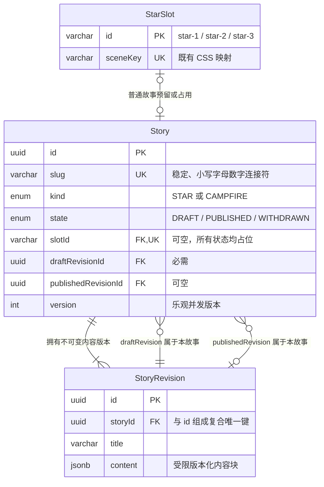

# P2-03：故事生命周期与稳定星位

对应 [Issue #12](https://github.com/SynapseOperator/mq-story-blog/issues/12)，承接 PRD v1.1 §5.3、§5.4、§7、§10，以及 FN-08/09/10/14 的领域基础。本轮只有数据库和内部服务，没有写入路由、Server Action、管理员页面或鉴权实现。已验收 MQ 页面继续使用原演示适配层。

## 数据关系

`Story` 是稳定身份和当前状态；每次保存内容都追加 `StoryRevision`，不覆写旧版本。草稿和公开指针可以相同，也可以不同。保留内容历史用于本轮的版本隔离，没有实现版本选择/回滚界面、永久删除或清理历史版本。

`StarSlot` 只存稳定身份与场景映射，不把像素坐标、移动端星数或最终候选数量写死。新迁移插入 `star-1 → story-position--1`、`star-2 → story-position--2`、`star-3 → story-position--3`；新增其他星位仍可通过后续已审查的数据变更完成。修改已存在映射被数据库拒绝。本轮没有新增可见星星。

## 状态与显式发布

| 操作 | 前置状态 | 原子结果 |
|---|---|---|
| `createDraft` | 新身份 | 同一事务创建 Story 和首个版本；DRAFT / version 0，无公开指针 |
| `saveDraft` | 任一已有状态，编辑版本匹配 | 追加版本、切换草稿指针；状态、公开指针和已有星位不变 |
| `reserveSlot` | DRAFT + STAR，编辑版本匹配 | 选择、调整或显式释放草稿预留；数据库唯一约束裁决冲突 |
| `publish` 首次发布 | DRAFT；普通故事已有星位 | 公开指针切到当前草稿，状态变为 PUBLISHED |
| `publish` 发布更新 | PUBLISHED；草稿尚未发布 | 仅显式操作时切换公开版本，星位不变 |
| `withdraw` | PUBLISHED | 变为 WITHDRAWN，保留公开指针和星位，但公开读取返回 null |
| `restore` | WITHDRAWN | 恢复 PUBLISHED，保留原公开版本，不顺带发布新的草稿 |

除首次创建外，每次修改必须携带读取时的 `expectedVersion`。事务内 `UPDATE ... WHERE id AND version AND state` 同时比较并递增版本；影响行数不是 1 时抛出冲突，整个事务回滚，包括刚写入但未被接受的新内容版本。不会自动重试过期编辑或用最后写入者覆盖别人。

发布与保存并发时，无论谁先成功，另一个旧版本操作均需重新读取确认；星位竞争由真实唯一索引裁决，不使用“先查空闲再写入”作为唯一性保障。服务在短交互式事务内完成变更，不调用外部服务。

## 哪些不变量由数据库保证

新增迁移：`prisma/migrations/202610230002_story_lifecycle/migration.sql`。历史 `202610230001_database_foundation` 保持不变；新迁移用事务创建表、约束、触发器与三个星位种子，不创建任何故事或用户。

| 数据库机制 | 保证的行为 |
|---|---|
| Story 主键、唯一 slug；身份触发器 | ID、slug、类别稳定，不能通过普通 UPDATE 改写 |
| `story_slot_id_key` 唯一索引 + 外键 | 任一有效星位最多绑定一篇故事；草稿预留和下架保留都参与竞争 |
| `story_single_campfire_key` 部分唯一索引 | 所有状态合计至多一篇 CAMPFIRE；不是对全部 kind 值做普通唯一约束 |
| kind/slot、publication/state CHECK | 篝火不能占普通星位；普通故事公开/下架时必须有星位；草稿无公开指针，公开/下架必须有公开指针 |
| `(Story.id, revisionId) → (StoryRevision.storyId, id)` 复合外键 | 草稿和公开版本不能引用其他故事；必需草稿必须存在 |
| 复合外键 `DEFERRABLE INITIALLY DEFERRED` | 可在一个事务内先创建 Story 再创建首个版本；错误引用不能通过提交 |
| 不可变版本触发器 | 禁止版本 UPDATE/DELETE；新草稿不能改变旧的公开快照 |
| 生命周期触发器 | 禁止跳过首次发布、退回 DRAFT、改变已发布星位；首次发布/发布更新指向当前草稿，下架/恢复保留原公开版本 |
| 版本递增触发器 | 修改必须恰好 version +1；仍需服务在 WHERE 中比较编辑者持有的版本 |
| 星位不可变触发器 | 禁止现有 StarSlot UPDATE/DELETE，但允许未来新增，不限制总数量 |
| 标题、slug、JSON 基本 CHECK | 非空标题、slug 格式、版本 1 JSON 对象和 blocks 数组；JSON CHECK 显式拒绝 NULL |

Prisma Schema 表达常规唯一键、枚举、关系与索引。部分唯一索引、CHECK、触发器和外键延迟检查由原生 SQL 维护并注明；Prisma 的 schema diff 不覆盖这些原生行为，不能单靠 diff 退出 0 验收，必须同时运行绕过服务的真实 SQL 反例测试。未来生成迁移时须审查并保留这些原生约束。

数据库维护身份仍能执行 DDL；上述约束不替代未来应用角色的最小权限、认证或管理员服务端鉴权。当前本地/CI 数据库初始化身份的权限不能直接用于生产网站。

## 哪些不变量由内部服务保证

实现位于 `src/server/stories/service.ts`，通过显式 client 工厂注入数据库连接，不读取浏览器角色状态，也不声称完成权限校验。未来认证/管理员入口必须先验证服务端身份和权限，再调用这些方法；本轮没有任何对外写入口。

- 完整输入语义和受限内容校验；未知块和字段被拒绝。
- 操作意图：禁止重复发布同一草稿、禁止在下架状态直接发布更新、禁止对已发布/下架故事调整预留星位。
- `expectedVersion` 的原子比较、完整事务和失败回滚；数据库递增触发器本身不能识别编辑者是否使用了旧版本。
- `getPublicStory` 仅筛选 PUBLISHED，显式选择公开版本的标题/正文，不返回草稿指针、历史版本或私有草稿正文；未发布、下架、不存在均返回 null。
- 冲突、无效状态、无效输入和不存在有明确领域错误码；没有将这些错误包装成已发送到客户端的正式 API 响应。

正文契约为 `{ version: 1, blocks: [...] }`，支持普通/强调/加粗段落，以及图片地址、替代文本和可选说明。标题最多 160 字符，1–200 个块，每段最多 10,000 字符，整个正文最多 256 KiB UTF-8。图片只允许无凭据 HTTPS URL 或 `/story-media/` 下无穿越的路径；当前只存元数据，不抓取、上传或渲染图片，也不把任意 HTML 当作可信标记。未来远端图片获取还需单独设计来源许可、代理/网络访问限制和公开隐私流程。

## 验证与剩余工作

`npm run test:db` 复用 P2-02 的隔离测试入口，从两个随机空库部署全部迁移，再验证领域服务与原生约束；不会清空开发库、`mq_test` 或其他数据库。测试只使用合成数据，新辅助星位也仅存在于该次临时库。退出时逐项尝试断开连接和删除本轮临时库，某项清理失败仍尝试其余项目并保留失败结果，不强制断开其他会话。

本地 `npm.cmd run check` 退出 0（26 项单元测试），`npm.cmd run test:db` 退出 0（31 项检查，含 20 项领域集成）；最终提交及 CI 证据以 Draft PR 为准。测试覆盖真实并发抢位、过期编辑、双版本公开隔离、下架/恢复、跨故事复合外键、原生唯一性/触发器、事务回滚和第二隔离库不受影响。并发保存使用真实 PostgreSQL 行锁，并从另一测试连接确认两个版本 INSERT 都已等待锁后才释放，证明失败方经过写入路径仍整体回滚；改绑测试使用真实空闲星位，避免仅因 NULL 或其他约束被拒绝而假通过。既有 CI 已调用该测试入口，因此从空库执行全部迁移与新增领域测试，无需新增替代数据库。

开发库的 `npm.cmd run db:migrate`、`npm.cmd run db:status` 均退出 0；只新增第二条迁移和三个稳定星位种子，核对两条迁移均 finished、Story/StoryRevision 各 0 行，未写入演示业务记录。本机 PostgreSQL 18.6、Prisma 7.10.1 沿用已验收版本；`.env.db.local` 仍被忽略，未重新生成。

生产 Chromium 冒烟复用 `frontend-testing-debugging` 和既有 Playwright（Browser plugin 不可用），1536×1024、390×844 共 10/10 通过，脚本退出 0。首页、故事星、羽毛信、关闭恢复与篝火文章正常，意外 console/runtime/HTTP 错误及写请求均为 0。验证的是本轮未提交实现的生产构建 `PscFJ1o4dntFH5WpfAFQe`；随后再次执行工程检查未改变应用源码。截图和 JSON 留在任务证据目录 `mq-p2-03/`。本轮未重跑完整历史阅读器套件、严格像素对比、其他浏览器或实体手机；不是重新授予视觉验收。

尚未实现：真实账号/管理员权限、管理页面/编辑器、正式发布 API、页面数据库适配、公开分享 URL、上传与图片服务、真实内容、点赞/留言、业务备份恢复和部署。FN-08/09/10/14 本轮只验证领域基础，不宣称后台或前端完整业务验收通过。不自动合并本任务 PR，不进入 P2-04。

约束与事务实现参考 [PostgreSQL 18 Constraints](https://www.postgresql.org/docs/18/ddl-constraints.html)、[Partial Indexes](https://www.postgresql.org/docs/18/indexes-partial.html)、[Prisma 7 Transactions](https://www.prisma.io/docs/orm/v7/prisma-client/queries/transactions)。
