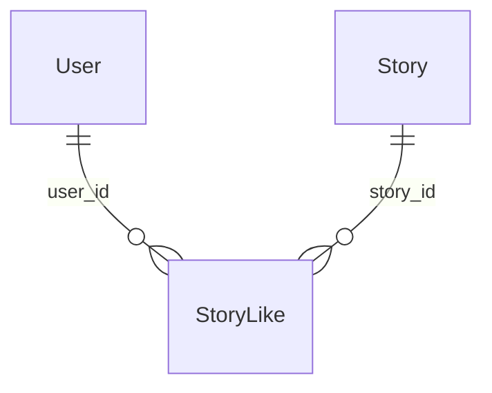

# 公开故事点赞

对应 [Issue #41](https://github.com/SynapseOperator/mq-story-blog/issues/41)、PRD v1.1 §08（8.2/8.3）及原型验收清单 FN-03/FN-04。P2-11 只将公开羽毛信的点赞改为持久化业务；留言仍是演示，管理员私有预览不显示点赞。P2-10B 已合入 main `0bbe77a1c42a13ee2e10da7384da818d1ffe90ac`，本分支从该提交开始。

## 数据与事务

007 新增 `story_like`，Prisma 模型为 `StoryLike`。`(user_id, story_id)` 是复合主键，分别以 RESTRICT 外键关联 User 与 Story；`story_id` 索引支持计数。没有客户端可写的总数或重复的计数缓存。001–006 保持不变。

数据库保证用户/故事存在和每对身份最多一条记录；服务端保证只对当前 PUBLISHED 故事操作、真实 Session、Origin、输入和事务边界。下架不删除点赞，恢复后原记录重新可见。不存在注销账号或删除故事的业务入口，未来增加时必须明确处理这些 RESTRICT 外键。

PUT/DELETE 的路径为：校验请求 → Better Auth 签名 Cookie 与数据库 Session → 短事务重新检查身份并锁 User、Session、Story → INSERT ON CONFLICT DO NOTHING / DELETE → COUNT → 提交。Story 锁与下架串行，Session 锁与退出/撤销串行；等待 Story 锁后再次按数据库时间检查会话有效期。先提交的操作决定顺序，撤销或下架完成后的新操作被拒绝。

`mq_lock_story_like_access(text,text,uuid)` 仅验证身份、状态和获取行锁，不执行通用更新。采用固定 SQL、限定 public 对象、`search_path=pg_catalog`，撤销 PUBLIC EXECUTE。这样无需为行锁授予应用账号对 Session 或 Story 发布字段的 UPDATE；依据见 PostgreSQL 18 的[行锁规则](https://www.postgresql.org/docs/18/explicit-locking.html)和 [SECURITY DEFINER 安全约定](https://www.postgresql.org/docs/18/sql-createfunction.html#SQL-CREATEFUNCTION-SECURITY)。事务外没有可复用的“已授权”标志。

## HTTP 合同

| 方法及路径 | 身份 | 结果 |
|---|---|---|
| GET `/api/stories/[id]/likes` | 游客或有效会话 | `{count, liked}`；游客 liked=false |
| PUT 同路径 | 有效数据库会话 | 确保当前用户已点赞，重复 PUT 不新增记录 |
| DELETE 同路径 | 有效数据库会话 | 确保当前用户未点赞，重复 DELETE 不报重复删除错误 |

写入必须使用同源 Origin、JSON 空对象 `{}`，拒绝 userId、角色、额外字段、查询参数和方法覆盖头。复用已配置的可信代理来源与数据库共享限流，不相信任意 X-Forwarded-For。GET 在认证关闭时仍可匿名读取计数；配置或数据库故障不能假装读到了零个点赞。

只返回 count 与本人 liked，不返回点赞名单、用户名、内部邮箱、Session 或其他认证字段。草稿、下架、不存在和非法故事 ID 统一 404；无有效会话写入为 401；来源拒绝为 403；超限为 429；基础设施故障为脱敏 503。所有结果 `private, no-store`、`Vary: Cookie`，不通过共享缓存复用个人状态。其他方法为 405，不提供 toggle。

## 数据库最小权限

| 对象 | 点赞运行身份新增权限 |
|---|---|
| story_like | SELECT、INSERT(user_id,story_id)、DELETE |
| mq_lock_story_like_access | EXECUTE |
| User / Session / Story 发布字段 | 不增加 UPDATE、DDL 或对象所有权 |

`scripts/likes/configure-privileges.mjs` 是显式、仅随机隔离测试库的配置工具，不是应用启动钩子。它要求独立配置身份，拒绝 superuser、对象所有者、可切换角色、DDL 和发布字段写权限。公开只读测试身份仅增加 story_like SELECT。生产角色配置仍需独立审查与授权；未在开发库或生产库自动实施。

这是 HTTP Session 边界和受限应用身份设计，不宣称运行数据库连接泄露后还能按最终用户隔离 SQL：应用本身需要读取和修改点赞记录。数据库凭据、日志和备份仍须保密。锁函数所有者沿用迁移身份，生产受限所有者配置属于既有开放前门槛。

## 阅读器行为

`PublishedStoryLike` 只挂载在数据库公开故事中。按故事和当前会话隔离加载结果；写入期间禁用爱心，数量只采用服务端确认值。网络错误或 5xx 可能发生在提交之后，因此仅 GET 核对，不自动重复写入；核对失败保留未确认提示，必须成功重新读取后才能继续。

游客点击爱心复用 AuthDialog。登录或取消不会卸载羽毛信，不改变 URL、留言草稿或文章滚动；登录后重新读取状态，由用户再次明确点赞。演示故事保留带说明的本地交互，不能与真实计数混用。留言的“预览留言（不发送）”不调用真实留言服务。

未知写入后的 GET 只证明读取时的状态，不证明原请求已结束。因此成功重读仍保留“上次请求结果未确认”及人工重新读取按钮；不新增后台任务或承诺离线顺序。浏览器测试实际丢弃已提交写入的响应，再验证没有自动重发。

## 验证与开放边界

`npm run check` 包含类型、lint、单元测试和生产构建；`npm run test:likes` 使用随机 PostgreSQL 库及受限身份，覆盖约束、并发、Session、公开隔离、真实 HTTP/HTTPS 和生产浏览器。图片迁移套件保留 005→006，再验证 006→007；备份恢复检查加入非空点赞记录。所有既有套件仍在 CI 执行。

实际命令退出码、Windows 与 Linux 结果及截图在本 PR 验收证据中记录，不能将此操作说明当作通过证据。Windows 测试截图可由 `LIKES_BROWSER_EVIDENCE_DIR` 指向仓库外目录；不导出 Cookie、密码或会话产物。

认证/发布默认关闭或受控启用机制不变。生产身份、HTTPS/可信代理、Session Token 原值存库、日志及备份保护和独立安全审查仍未由本任务完成。不创建真实用户或生产密钥，不部署，不开始真实留言。

### Windows 验证记录（2026-11-04）

- `npm run check` 退出 0：165 项单元测试通过，2 项既有 Windows 文件系统用例跳过，lint、Schema、类型检查及生产构建通过。
- `npm run test:likes` 退出 0：PostgreSQL 7/7、HTTP 10/10、HTTPS 11/11、生产浏览器 15/15。覆盖非法 ID、请求身份注入、会话撤销/过期、并发、429、真实进程重启、响应丢失及嵌套登录。生成 1536×1024、390×844、320×568 的 7 张截图；窄屏使用触屏及 reduced-motion。
- `test:media` 验证空库 001→007、分别升级 005→006 与 006→007、历史迁移校验和及 Prisma drift。`test:publishing` 的 6 项真实备份恢复检查确认非空点赞记录完整保留，恢复后发布权限仍默认拒绝。
- 首次新 HTTP 套件失败源于测试客户端 DELETE 缺少 Content-Length，已修测试传输并完整重跑；应用接口未为此放宽校验。首次失败记录与最终日志分别保留在仓库外。
- 原 Compose 端口 55432/55433 落入 Windows 保留区，`db:up` 退出 1。没有修改系统规则、已有 `.env.db.local` 或卷；本轮使用回环端口 56333 的独立临时 PG 18.6 容器，全部业务测试仍逐次创建自己的随机数据库。原 Compose 的本机持久化检查未重跑，Linux CI 保留该检查。

以上是工程证据，不代表产品视觉或独立安全评审通过。

### 移动端视觉精修（同一 PR #42）

本次只调整组件呈现、样式和浏览器检查，不修改点赞请求、认证业务、数据库或权限。AuthDialog 增加 reader 外观：手机端最大宽度 328px，使用不透字的深蓝底色，精简说明，输入及主要按钮保留至少 44px 触摸高度。仅嵌套窗口按 VisualViewport 的高度和偏移调整位置；首页登录外观不变。留言辅助文字调整为 12px、身份及操作文字 14px、输入 16px，减少重复说明，留言仍明确不会发送或保存。

截图同时保留 `scale: "css"` 和 `deviceScaleFactor: 2` / `scale: "device"`。390×844 输出 780×1688，320×568 输出 640×1136，桌面 1536×1024 输出 3072×2048。精修前后使用相同倍率；文字模糊主要来自原 CSS 像素截图放大，原来的小辅助字号也影响阅读，未重新生成信纸素材。

最终生产构建的本机结果：

- `npm run check` 退出 0；最终背景不透明度微调后再次 `npm run build`，退出 0。
- `test:likes` 退出 0：PostgreSQL 7/7、HTTP 10/10、HTTPS 11/11、生产浏览器 20/20。保留原有功能检查，增加 320/390 登录、注册、小高度和首页窗口回归，输出 32 张 PNG。
- `test:public` 退出 0：公开读取 15/15、分享 10/10。
- `test:admin-preview` 退出 0：数据库 12/12、HTTP 20/20、HTTPS 4/4、生产浏览器 14 项。

精修过程中发现身份行换行造成登录后阅读位置跳动 25px，已通过保持身份行布局修复，原滚动位置断言未放宽。原生 dialog 的 Tab 可能经过浏览器工具栏，因此检查允许该浏览器边界，但下一次 Tab 必须返回窗口，并单独确认底层阅读器不可获焦。未加入新的焦点管理逻辑。

390×420、320×360 验证的是可用高度缩小后的登录和注册；不是 iOS/Android 真机键盘或输入法验收。日志、失败记录及同倍率前后对比图保存在仓库外，不含密码或 Cookie。技术检查通过，产品视觉验收待负责人确认。
