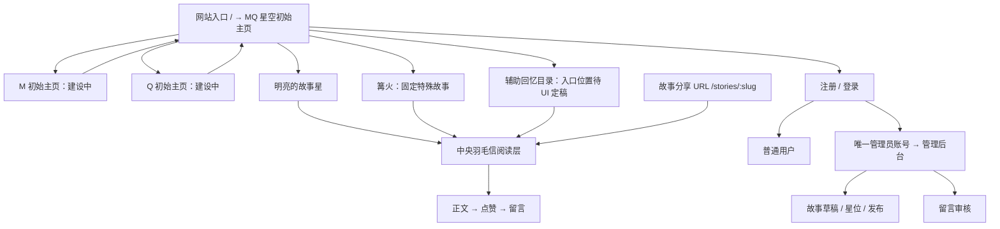
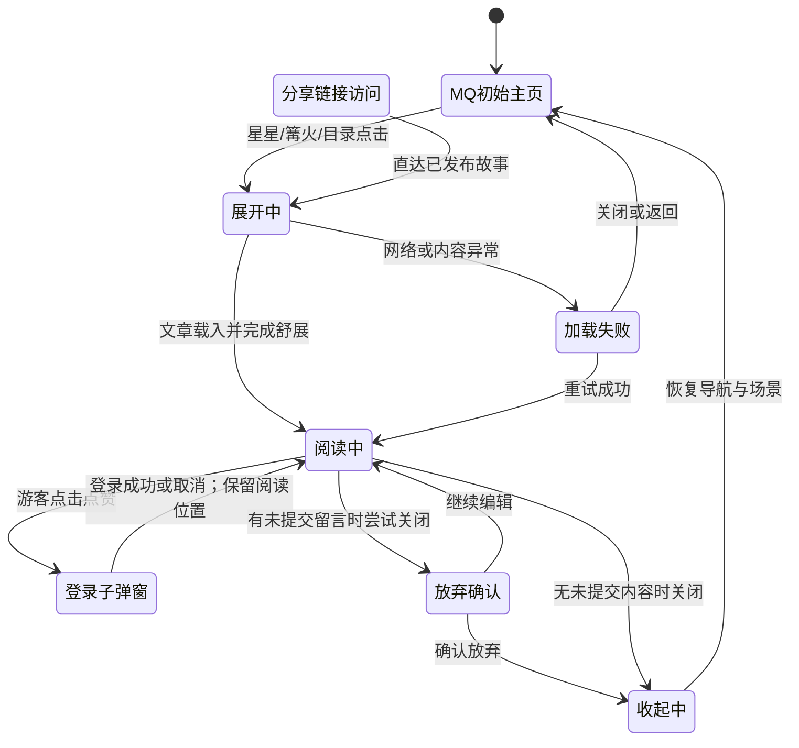
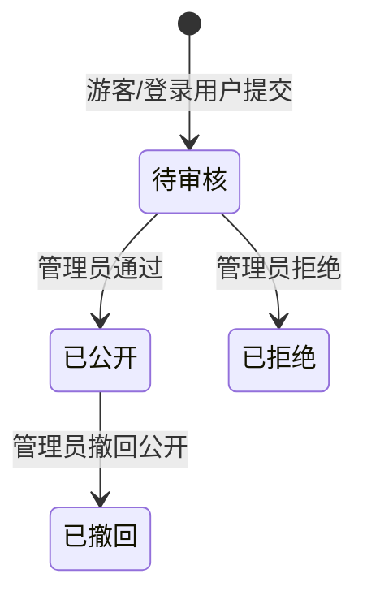
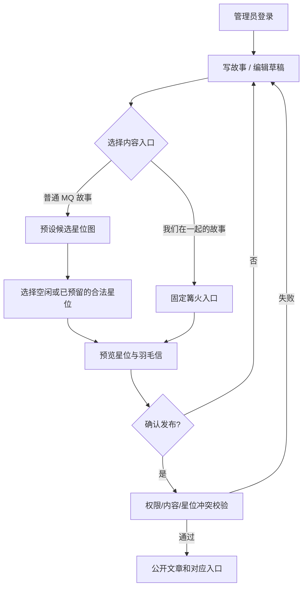

# MQ 共享主页 · 产品需求文档（PRD v1.1）

> **版本**：v1.1 ｜ **日期**：2026-10-21 ｜ **阶段**：需求审查完成，进入交互原型准备  
> **产品名称**：MQ · Our Stories（暂定）  
> **范围**：MQ 共享主页、故事羽毛信、账号互动、管理员内容后台；M/Q 独立主页仅提供建设中占位  
> **实施约束**：本文用于产品设计与后续工程规划，**不意味着已经开始编码或部署**。

**需求状态说明**：**[确认]** 为产品负责人已明确选择；**[默认原则]** 为产品负责人同意纳入的异常处理、安全与质量要求；**[待原型验证]** 为效果和参数尚未冻结的 UI 细节；**[未来迭代]** 不在 MQ 首版开发范围内。除“待原型验证”外，关键业务行为可作为下一阶段的需求基线。

*图 0｜已认可的视觉方向。图中 Logo 的具体位置、湖泊、远处村镇、灯具等不覆盖已确认的文字要求：MQ Logo 应在中央上方；必须有茂盛青草的山坡与篝火；没有萤火虫。本文不要求逐像素复刻概念图。*

---

## 01｜产品定位、目标和边界

### 1.1 产品定义

**[确认]** MQ 是一套以 M 和 Q 的共同恋爱回忆为主题的**个人博客系统**。访问者进入网站时，首先看到星空、青草山坡、并肩而坐的情侣及篝火；点击明亮故事星星或篝火，在同一场景中央展开十九世纪欧洲风格的浪漫旧情书，阅读文章、图片及末尾的“留言”。

博客内容由专用管理员账号维护，普通注册用户不具有发表正式博客文章的权限。因此网站不属于“人人可以发帖”的 X 式社交平台；信息呈现可以借鉴其轻量互动体验。

### 1.2 目标

- **纪念性**：一颗稳定的故事星对应一段真实回忆；新增故事，星空逐渐生长。
- **沉浸性**：读信时保留但暗化原主页，信纸和留言处在同一阅读流中。
- **可运营性**：管理员通过后台编辑、发布、下架、审核和选位，不依赖修改网站代码。
- **可验收性**：满足课程个人博客的登录、文章发表、评论与工程全过程展示要求。

### 1.3 范围

| 范围类型 | 内容 | 备注 |
|---|---|---|
| 本阶段核心 | MQ 场景、环境动画、星尘和故事星、篝火、羽毛信、文章阅读与链接 | 第一阶段交互原型优先验证 |
| 本阶段业务功能 | 用户名密码账号、点赞、匿名/登录留言及审核、单管理员后台、文章草稿/发布/下架、预设星位绑定 | 完整应用阶段实现 |
| 占位交付 | M、Q 初始主页的“建设中”页面及返回/切换入口 | 不提前设计其正式博客 |
| 未来迭代 | M/Q 正式个人主页、星星自由拖拽编辑器、星座分类、复杂目录检索 | 需要新的需求评审 |
| 明确排除 | 萤火虫、可点击青草或情侣人物、普通用户发布博客、关注/私信/转发/推荐算法、自动背景音乐 | 不为美术效果私自新增 |

## 02｜用户身份与权限

| 身份 | 可以做什么 | 不可以做什么 |
|---|---|---|
| 游客 | 查看 MQ 场景与公开故事、读已审核留言、匿名提交待审核留言、查看点赞数 | 点赞、发表博客、审核留言、进入后台 |
| 普通用户 | 用户名+密码注册/登录/退出；阅读、以登录身份留言、点赞/取消点赞 | 发布文章、选星位、管理评论和权限 |
| 管理员 | 普通用户权限 + 文章与故事入口管理、审核留言 | 不经校验绕过业务约束 |

**[确认]** 后台只有**一个专用管理员账号**，由 M 与 Q 共同使用；普通用户公开注册无法选“管理员”。管理员的发布、审核等操作必须通过服务端身份与权限校验。共享账号不能可靠区分两位使用者各自进行的操作，双方已接受此限制。

**[确认]** 普通用户采用**用户名 + 密码**注册/登录，注册时需重复确认密码；第一版不依赖邮箱验证、邮件服务或自动密码找回。密码不得明文存储，后台密钥不得出现在前端或代码仓库中。管理员凭据丢失时的安全重置手段应纳入运行维护方案。[默认原则]

## 03｜页面结构与导航状态

### 3.1 信息架构

### 3.2 导航显示规则（重要更新）

**[确认]** 左侧半透明 **MQ / M / Q** 导航只在各个分区的**初始主页界面**显示，并在这些初始页中固定在界面位置，不随场景视差或页面滚动移动。

| 所在状态 | MQ/M/Q 导航 | 右上角常规登录入口 |
|---|---|---|
| MQ 星空初始主页 | 显示、位置固定 | 显示 |
| M / Q 初始主页（当前为建设中） | 显示、位置固定 | 根据同一站点统一账号入口显示 |
| MQ 羽毛信打开 / 阅读 / 关闭动画期间 | **隐藏** | **隐藏** |
| 后台或将来的分区次级页 | 不显示该主页导航 | 由该页自身界面处理 |

在 MQ 初始页可随时切换 MQ/M/Q；进入阅读层后不可通过隐藏的导航直接跳往其他主页。关闭羽毛信回到 MQ 初始页时，导航与常规登录入口恢复。M/Q 建设中页应可回到 MQ，具体美术样式后续 UI 定稿。

## 04｜MQ 首页视觉与环境动效

### 4.1 静态构成

**[确认]** 整屏夜晚、星空、茂盛青草山坡；情侣并肩坐在山坡仰望夜空；旁边有可识别的篝火。**没有萤火虫**。艺术化 **MQ Logo 位于画面中央上方**；左侧半透明导航与右上角注册/登录位于界面层。背景图中的湖泊、村镇、灯具、装饰花朵不是必须元素。

**[确认]** 场景里**只有明亮故事星星和篝火是故事入口**。青草、人物、Logo、低亮度背景星尘不打开故事；这不影响导航、登录和信纸内其他操作控件的正常交互。

### 4.2 动态层次

| 视觉层 | 行为 | 设计状态 |
|---|---|---|
| 低亮度背景星尘 | 细微、彼此不同步的亮度波动；无点击反馈 | 已确定装饰职责；动效幅度待验证 |
| 故事星星 | 柔和闪烁、悬停增强光晕和显示故事标题、点击触发读信 | 已确认交互；节奏待原型验证 |
| 茂盛青草 | 少量前景草叶轻柔摆动，地形轮廓稳定 | 原型建议 |
| 情侣人物 | 静态为主，允许极轻微发丝/衣角变化 | 原型建议 |
| 篝火 | 自然燃烧；鼠标悬停时**火焰明显变旺，周围暖光增强**；移开逐步恢复 | 已确认 |
| 鼠标镜头 | 轻微视差，远近景有细小位移；固定 UI 不位移 | 已确认 |

**[待原型验证]** 远景 ±3–4px、中景 ±6px、近景 ±10px 的位移，篝火悬停增幅约 15%–25%、过渡约 250–350ms、恢复约 400–600ms，仅作为试验起点。增强的是**火焰和光照**，不是把木柴整体放大。移动端无需模拟鼠标悬停。

## 05｜星空故事规则与故事目录

### 5.1 两类星光

- **[确认] 背景星尘**：细小、低亮度、仅为背景，不可点、无标题、无文章绑定。
- **[确认] 故事星星**：更明亮、有温柔光晕；**每颗绑定一篇已发布的 MQ 普通故事**。不同故事打开不同羽毛信，不以点赞热度改变星星大小。

### 5.2 成长与位置

**[确认]** 采用 **E：自由散落 + 持续生长**。首版**预设候选星位（A）**，管理员在空闲星位中选择；未来实际需要时再实现自由拖拽（B）。新增故事点亮新星，已有故事的逻辑星位默认稳定，不因新增内容自动重排。

- 候选位置避开 MQ Logo、导航、账号入口、人物与篝火的视觉安全区。[默认原则]
- 一个逻辑星位同一时刻不得被两篇文章占用；发布冲突必须清晰提示。[默认原则]
- 后台可以看见候选空星位；公开星空不可显示看似能点却没有文章的故事星。[确认]
- 草稿可预留星位；已下架文章保留原绑定但前台隐藏，重新发布时可复用。[既有建议，作为内容管理默认规则]
- 桌面和移动端可采用不同可视坐标，但同一逻辑星位绑定同一篇故事。[默认原则]
- 首版候选星位数量、初始故事数量和满额扩展方式不锁定；满额时不能挤占已用位置。[待原型验证]

### 5.3 点击与发现

**[确认]** 桌面鼠标悬停故事星时，光晕增强并显示故事标题；点击或触屏点按后，开启同一羽毛信阅读层。必须保证视觉星与可点区域对齐（包括视差位移时）；不让背景星尘产生误导性点击反馈。[默认原则]

### 5.4 特殊篝火

**[确认]** 篝火固定对应单篇《我们在一起的故事》，不与普通星位互换，不自动扩展为随机故事或专题合集。若专属故事尚未公开，不能提供打开不存在文章的有效入口；公开首版应优先准备这篇核心故事。[默认原则]

### 5.5 辅助故事目录

**[确认]** **移动端采用“星空 + 可收起的回忆故事目录”**：星星始终是主要探索方式，辅助目录按照故事标题列出可公开阅读的文章；从目录选择文章，仍打开同一羽毛信阅读层。目录随发布、编辑、下架自动同步。**目录位置、展开形态、触发控件样式尚未确定，必须等整体 UI 原型评审，不允许先固定在顶部或侧边。**

桌面端是否展示相同目录不在本轮锁定范围内。[待原型验证]

## 06｜羽毛信视觉与核心阅读交互

### 6.1 风格和内容

**[确认]** 采用此前参考 **E 的真实旧信质感 + B 的温柔浪漫情书气质**：米黄旧纸、细微纸纤维、边缘轻度磨损、深棕墨色；正文区域克制、清晰。信纸可带羽毛笔装饰；不采用明显卷轴木轴、夸张烧焦边、通篇难读花体。

信纸内容依次为：**故事标题 → 可选书信式开场/日期信息 → 正文及图片 → 点赞 →「留言」输入与列表**。文章和留言使用**同一信纸背景和一个纵向阅读滚动区域**；书信式开场由文章自己决定，不强制所有文章套用固定问候语。

### 6.2 展开与收起

**[确认]** 用户点击故事星或篝火，原 MQ 场景保留但暗化；左侧导航和右上角账号入口淡出并隐藏；信纸在屏幕中央**从上往下平滑舒展**，有轻微旧纸自然展开感，标题正文随后淡入。它不是折痕逐段翻转，也不是卷轴。信纸占屏幕中央的有限空间，较长文章靠内部滚动阅读；背景停止响应其他故事入口。

**[待原型验证]** 桌面信纸宽约 680–760px、最大高度约视口 85%；打开总时长约 0.9–1.1s，关闭约 0.35–0.5s，暗色遮罩约 60%。这是试验参数，不锁定最终尺寸、亮度和速度；文字不能随纸张纵向拉伸。

**[确认]** 关闭渠道：信纸关闭按钮、信纸外围暗区点击、桌面 `Esc`。如果存在**尚未提交的留言内容**，关闭前询问是否放弃；选择继续编辑则关闭取消，内容保留。关闭成功后信纸向上收起、夜景复亮、导航与账号入口恢复。

### 6.3 状态规范

阅读期间最多出现一封羽毛信；快速连点不可叠加多个弹层。打开或关闭动画进行中不允许触发冲突操作。[默认原则]

## 07｜独立故事链接与浏览器行为

**[确认]** 每篇已发布文章拥有稳定可分享的链接（示例 `/stories/:slug`，实际域名待部署确定）。

- 从 MQ 首页点击故事星、篝火或目录：**羽毛信在同一场景展开，同时地址栏更新为该篇文章链接**。
- 直接打开分享链接或刷新链接：先载入 MQ 场景作为变暗背景，再打开与首页点击效果一致的居中羽毛信；导航/常规登录入口在阅读状态隐藏。
- 点击信纸关闭按钮或暗区确认关闭：返回 MQ 初始页与其地址。
- 从 MQ 首页打开故事后，浏览器“后退”应可回到 MQ 阅读前的状态；对从外部直达链接的“后退”，尊重正常浏览器历史，不强行劫持回退目标。[默认原则]
- 草稿、下架或不存在的 URL 不得泄露文章正文，显示友好提示并允许进入 MQ 主页。[默认原则]

## 08｜账号、点赞与登录子弹窗

### 8.1 注册登录

**[确认]** 普通账号使用用户名和密码；游客可浏览和匿名留言，登录不作为阅读前提。右上角常规账号入口仅在初始主页显示。管理员使用同一站点的认证机制，但账号是单独受控创建的唯一管理员，普通注册不能获得后台权限。

### 8.2 点赞

**[确认]** **登录后才能点赞，并且允许取消点赞**：同一账号对同一故事最多有一个有效点赞；点亮/取消状态和数量在刷新与重新登录后仍正确。游客可以看到公开点赞数，但不能直接点赞。服务器负责防止重复计数，不信任仅存在于浏览器的数字变化。

### 8.3 羽毛信里的登录流程

**[确认]** 游客在羽毛信内点击点赞，**在信纸上方弹出小型登录窗口**，不关闭当前羽毛信。登录成功或取消后，返回**同一篇故事、同一阅读滚动位置**；如有正在输入但未提交的留言也应保留。普通用户登录后可以继续执行点赞，系统不应擅自清空故事阅读状态。

## 09｜留言与审核

**[确认]** 文章底部称为 **「留言」**，与正文同纸连续滚动；游客可匿名留言，已登录用户可用账号身份留言；**所有留言均须管理员通过审核后才向公众展示**，登录用户不享有免审特权。

**[默认原则]** 提交成功仅提示“留言已提交，审核通过后会显示”，未审核留言不计入公开数量。失败时保留文本并提供重试，防止短时间重复提交；展示时安全处理文字，避免脚本注入；匿名留言应有合理频率限制与滥用防护。第一版采用单层留言，不做复杂嵌套回复树。

## 10｜唯一管理员后台与发布流程

### 10.1 后台能力

| 模块 | 功能 | 边界 |
|---|---|---|
| 故事管理 | 新建、编辑、保存草稿、预览、发布、下架、恢复 | 仅管理员；不因删除误操作丢失重要回忆 |
| 星空选位 | 后台可视化展示已占用/空闲/草稿预留位置；选取预设空位 | 首版不支持自由拖拽 |
| 篝火管理 | 单独维护《我们在一起的故事》 | 不是普通空闲星位 |
| 留言审核 | 查看待审核、通过、拒绝、撤回公开 | 变更立刻反映在公开评论列表 |
| 管理员会话 | 登录、退出、服务端鉴权及基础安全维护 | 仅一个共享管理员账号 |

### 10.2 发布工作流

**[确认]** 管理员发表新故事是**应用内容管理操作**，不要求改网站代码、提交 Git 或重新执行 CI/CD。已发布文章修改后保留原星位；草稿和下架故事在公开星空与目录均不可访问。星位占用冲突必须被服务器拒绝并说明原因。[默认原则]

## 11｜异常处理、安全、质量与数据可靠性（默认原则已确认）

本节来自产品负责人对上轮集中审查表的整体确认，属于**默认设计原则**；具体阈值、部署工具或服务商尚不据此冻结。

| 分类 | 必须满足的行为 | 验证方式 |
|---|---|---|
| 文章缺失 | 不存在、未发布、下架文章不泄露正文；有友好提示和返回 MQ 的方式 | 直接打开异常 URL |
| 空内容状态 | 夜晚场景仍可展示；没有已发布故事时不出现虚假的可点击星星；篝火保留景物形象但不可打开空文章 | 空数据库/测试数据 |
| 网络异常 | 文章加载失败保留可理解的错误状态，允许重试或退出；阅读中局部数据失败不强制关闭信纸 | 模拟断网/接口失败 |
| 留言失败 | 不丢输入，提供重试；避免连续点击制造多份留言 | 模拟服务失败/重复点击 |
| 图片失败 | 图片加载异常不应使整个正文不可读或发生严重布局跳动 | 失效图片地址测试 |
| 移动端 | 核心星空、星星点按、目录、信纸滚动与关闭可用；布局不溢出 | 手机竖屏/横屏、触屏验证 |
| 性能 | 动态效果不阻塞点击和滚动；较弱设备可减少效果 | 主流设备实际体验 |
| 减少动态 | 尊重系统减少动画偏好，用静态或简短淡入淡出替代复杂位移 | 开启系统相关设置 |
| 访问权限 | 文章发布、星位分配、审核必须服务端管理员校验；普通用户直连管理 API 也被拒绝 | 角色越权测试 |
| 内容安全 | 对公开评论安全渲染，用户名/密码安全处理、会话保护和基础限流 | 安全与异常输入测试 |
| 公开隐私 | 真实故事、照片、日期等公开前由 M/Q 共同确认；展示演示数据避免私人信息外泄 | 发布前素材检查 |
| 数据可靠性 | 文章、星位绑定、点赞及留言持久保存；有基本备份和可验证的恢复办法 | 重启、备份与恢复演练 |

**注意**：某些性能上限、评论长度、限流阈值、备份频率和保留周期在架构设计时设定并验证，不能假装已由用户具体批准。

## 12｜编号验收标准

### 12.1 交互原型验收（允许采用演示数据）

| ID | 优先级 | 操作 | 通过条件 |
|---|---|---|---|
| UX-01 | P0 | 打开 MQ 初始页 | 星空、茂盛草地、情侣、篝火可见；无萤火虫 |
| UX-02 | P0 | 查看 Logo、导航和账号位置 | MQ Logo 在中央上方；初始页导航固定在左侧；账号入口右上方 |
| UX-03 | P0 | 点击 M/Q 导航 | 进入相应建设中初始页，并能返回 MQ；初始页有导航 |
| UX-04 | P0 | 鼠标移动 | 景物产生轻微视差，固定 UI 不移位，热点位置正确 |
| UX-05 | P0 | 对比星尘与故事星 | 背景星尘不可点，故事星可点且悬停显示标题 |
| UX-06 | P0 | 悬停篝火并移开 | 火焰及周围暖光明显增强，随后平缓恢复 |
| UX-07 | P0 | 点击两颗不同故事星 | 各自打开不同且正确的示例故事 |
| UX-08 | P0 | 点击篝火 | 打开固定的“我们在一起的故事” |
| UX-09 | P0 | 点击故事后观察 | 导航与常规登录入口隐藏，背景变暗，羽毛信中央自上而下平滑展开 |
| UX-10 | P0 | 向下阅读长文 | 正文、图片、点赞与「留言」在同一信纸上连续滚动，底层不滚动 |
| UX-11 | P0 | 关闭无草稿信纸 | 按钮/暗区/Esc 可关闭，场景复亮，初始页导航恢复 |
| UX-12 | P0 | 有未提交留言时关闭 | 弹出放弃确认；取消后留言文本仍在 |
| UX-13 | P0 | 手机点按星与回忆目录 | 两种方式均打开同一羽毛信；目录位置暂不以原型示例锁定 |
| UX-14 | P1 | 减少动画设置 | 可用简单转场完成阅读，不阻塞功能 |
| UX-15 | P1 | 多次快速点击 | 不叠加多个信纸和登录弹窗 |

### 12.2 完整功能与工程验收（原型之后）

| ID | 优先级 | 测试 | 通过条件 |
|---|---|---|---|
| FN-01 | P0 | 注册/登录普通账号 | 用户名密码注册登录退出正常，账号不能自选管理员 |
| FN-02 | P0 | 管理员登录 | 唯一管理员账户能够管理，普通用户直接访问后台及接口被拒绝 |
| FN-03 | P0 | 游客点击点赞 | 弹出信纸上方登录子窗，不关闭文章且保留滚动位置 |
| FN-04 | P0 | 登录后点赞、取消、刷新 | 状态准确，不能重复计数，刷新后保持 |
| FN-05 | P0 | 游客匿名留言 | 无需注册，可提交待审核，不立即公开 |
| FN-06 | P0 | 登录用户留言 | 同样进入待审核，不免审 |
| FN-07 | P0 | 管理员审核留言 | 通过才公开，拒绝和撤回不公开 |
| FN-08 | P0 | 编辑、预览并发布普通故事 | 选择预设空星位后发布；星空出现对应故事星 |
| FN-09 | P0 | 试图重用已占用星位 | 服务端阻止冲突，已发布故事绑定保持不变 |
| FN-10 | P0 | 草稿/下架/恢复 | 草稿不可公开，文章下架后星星和目录入口同步隐藏，恢复时原绑定保留 |
| FN-11 | P0 | 通过分享链接直达/刷新 | 载入 MQ 暗色背景与同一封羽毛信，阅读正常 |
| FN-12 | P0 | 从首页打开再浏览器后退 | 返回原 MQ 首页；关闭信纸也回首页 |
| FN-13 | P0 | 分享不存在或非公开故事链接 | 不泄露正文，展示友好失败状态 |
| FN-14 | P0 | 在后台发布新内容 | 无需修改 Git 仓库或重新执行代码部署就能上线新故事 |
| FN-15 | P1 | 留言/图片/网络失败 | 输入保留、可重试，正文仍可读，页面无严重错位 |
| FN-16 | P1 | 移动端布局与目录 | 点击目标不重叠，信纸可阅读与关闭，目录同步公开文章 |
| FN-17 | P1 | 内容安全与限流 | 非法脚本作为文本处理，重复请求和越权访问得到适当拒绝 |
| FN-18 | P1 | 备份和恢复 | 数据保存可靠，能通过至少一次恢复测试验证备份可用 |

### 12.3 关键端到端故事

1. **访问者读信**：MQ 初始页 → 故事星 → 羽毛信 → 文章 →「留言」→ 匿名发送 → 待审核提示 → 管理员通过 → 对公众可见。
2. **管理员点亮星星**：共享管理员登录 → 写草稿 → 选预设空星位 → 预览 → 发布 → 公开星空新增故事星 → 链接直达阅读。
3. **登录点赞不中断**：游客读信并滚动 → 点赞 → 小型登录窗 → 登录成功 → 回到同文章同位置 → 点赞/取消。
4. **非公开内容保护**：访问草稿、下架或错误 URL → 友好提示，不返回非公开正文。

## 13｜原型阶段、未决项及课程追踪

### 13.1 下一阶段只做可交互原型

- 使用**演示故事内容**，先验收场景分层、环境动效、星/火交互、信纸动效、滚动、关闭保护、手机目录与初始页导航。允许暂时模拟登录与后台演示，但必须标明模拟，不宣称系统已经具备真实认证、评论审核、持久化和部署。
- 通过视觉与交互审查后，再确定技术架构、数据模型、CI/CD 和两人任务拆分。
- **本 PRD 的完成不等于原型已完成；原型验收也不等于完整博客上线验收。**

### 13.2 留待原型或后续阶段确认

| 编号 | 尚未锁定的事项 | 决策时机 |
|---|---|---|
| OPEN-01 | 回忆目录入口的具体位置、样式及桌面端是否提供 | MQ 整体 UI 原型评审 |
| OPEN-02 | 信纸最终尺寸、字体、纹理、羽毛笔装饰、暗度和展开速度 | 信纸视觉原型评审 |
| OPEN-03 | 移动端星位排列、初始候选星位数量及满额策略 | 多设备布局评审 |
| OPEN-04 | 用户名/留言长度、密码政策、限流阈值、备份策略的具体参数 | 技术方案和质量验收设计 |
| OPEN-05 | M/Q 正式个人主页的功能、布局与风格 | MQ 完成后单独设计 |
| OPEN-06 | 是否引入星位自由拖拽 | 后续根据实际管理痛点决定 |

### 13.3 与课程 DevOps 要求的对应

| 课程评分维度 | 本项目后续留存的真实证据（规划） |
|---|---|
| 项目规划、工作项、迭代 | GitHub Projects、Issues、优先级、Iteration、工作分工和验收记录 |
| 开发提交、代码检查 | feature 分支、Git 历史、PR 互审、静态分析/检查输出 |
| 编译构建、持续集成 | GitHub Actions 自动测试/构建日志、构建产物与质量门禁 |
| 主机与部署 | 真实可访问运行环境、主机或等价托管平台配置及自动部署证据，具体方式待最终选型与老师验收口径确认 |
| 分支合并、持续交付 | PR 合并要求、部署流水线、版本和上线检查记录 |
| 过程总结、思考建议 | 真实缺陷修复、原型迭代、技术取舍、质量评审和改进说明 |

课程原始依据：《软件工程——敏捷 DevOps 方法》大作业 V1.1，要求个人博客支持登录、文章发布、评论，并对项目过程进行总结和建议。**老师允许替换华为 DevCloud 工具链，不代表改变博客选题。**

### 13.4 版本变更摘要：v1.0 → v1.1

| 变更领域 | 新版决定 |
|---|---|
| 管理员 | 从“人数待定”确认成**唯一专用共享管理员账号** |
| 用户认证 | 确定普通读者采用**用户名 + 密码**，首版无需邮件服务 |
| 点赞 | 从待定改为**登录后点赞、可取消、持久化防重复** |
| 登录子弹窗 | 羽毛信内游客点击点赞→信纸上方登录→保持文章及阅读位置 |
| 固定导航 | 澄清为**只在 MQ/M/Q 各初始主页显示并固定位置**，阅读层隐藏；常规登录入口阅读层也隐藏 |
| M/Q 占位 | 选择“建设中”初始页，保持导航及返回 MQ 能力 |
| 故事目录 | 移动端提供可收起辅助目录，**具体位置不固定** |
| 永久链接 | 每篇已发布文章有稳定分享链接；直达仍是 MQ 星空上的羽毛信 |
| 默认质量 | 明确异常、移动端、性能、减少动态、安全、隐私、备份恢复作为正式默认原则 |

---

## 附录｜概念图使用和需求优先级

**[确认]** 视觉参考图提供氛围基准，不允许把概念画面直接当作整张不可互动网页背景；场景、热点、信纸、正文和留言必须独立具备后续可实现的交互与响应式行为。

**优先级**：P0＝首版相应阶段必须通过；P1＝正式验收前建议完成或作为质量基线核查。原型的演示数据不应伪装成真实内容管理系统。

**结束状态**：核心产品需求审查结束；进入交互原型准备。所有标为“待原型验证”的设计参数保留调整空间；后续变更先更新 PRD，再调整实现任务。
